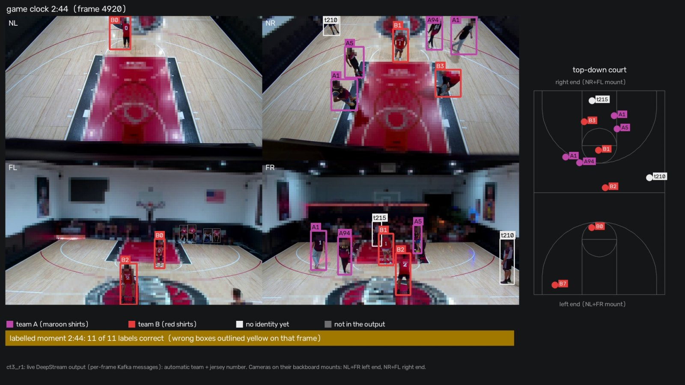
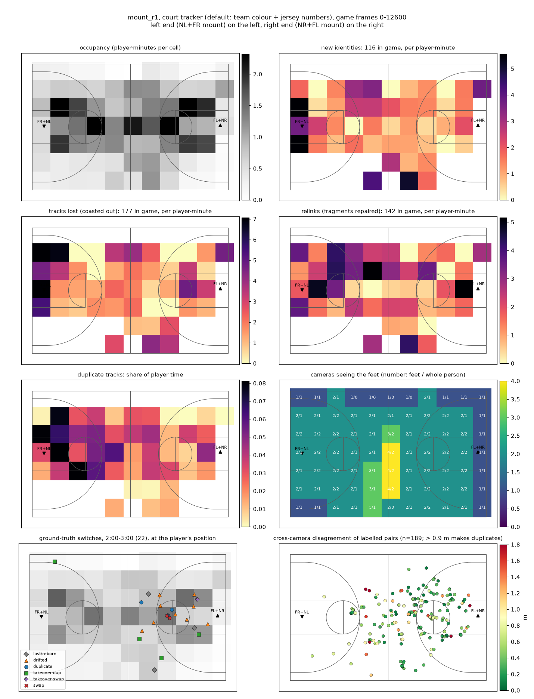

# Gym MV3DT

Multi-camera basketball player tracking with NVIDIA DeepStream 9.1 Multi-View 3D Tracking (MV3DT) and a court-plane
tracker that reports each player by identity (team + jersey number). Developed on Ubuntu 24.04 with an RTX 3060 Ti
(8 GB, driver 580); the target is a Jetson (AGX Orin), so everything that runs live is causal.

Results and the full write-up: [reports/phase7_report.md](reports/phase7_report.md).



*The court tracker running inside DeepStream (one frame of the live output, 2:44 into the test game): each player
labelled by automatically found team (A/B) and jersey number, and their positions on the court. Faces, the crowd,
signs and the floor logo are pixelated (`python -m tools.render_labels <run> --live --scale 1.5 --sanitize --still
<frame>`).*



*Where on the court tracks start, are lost, re-link and duplicate, per player-minute (`tools/court_heatmap.py`).*

## Cameras and calibration

| Stream | Camera | Mount | View |
|---|---|---|---|
| 0 | cam_00 NL | left backboard (with FR) | looks down at the left half |
| 1 | cam_01 FL | right backboard (with NR) | looks across at the left half |
| 2 | cam_02 NR | right backboard (with FL) | looks down at the right half |
| 3 | cam_03 FR | left backboard (with NL) | looks across at the right half |

Each pair shares one apparatus on top of a backboard, 6-10 in apart. The calibration (one 3 x 4 projection matrix per
camera, valid for **1920 x 1080 undistorted** frames) is fitted with each pair held together on its mount
(`tools/calib_mount.py`); it lives in `datasets/gym/camInfo/`, with earlier versions archived beside it (see
`datasets/gym/camInfo_README.md`). Each camera file also stores the court tracker's fixed position bias
(`courtTrackerBias_m`, measured with `tools/calib_bias.py`).

World frame: metres, origin at centre court, +x toward the right end, +y to the left when facing the right end, z up.
Court size and markings: `tools/court.py`.

## Setup

- One-time host setup (needs sudo): `./scripts/install_nvidia_container_toolkit.sh`
- Python venv at `~/.venvs/mv3dt` (set `MV3DT_VENV` to use another location)
- Brokers: `./scripts/brokers.sh start|stop|status` (mosquitto on :1883 for MV3DT's inter-camera messages; Kafka
  4.2.0 in `external/kafka_2.13-4.2.0` on :9092). Kafka must be restarted after a reboot.
- DeepStream: `external/DeepStream` at tag `v9.1.0.2`, image `nvcr.io/nvidia/deepstream:9.1-triton-multiarch`.
  The custom app (court filter, torso objects, jersey reads, court tracker) is built with
  `./scripts/build_court_app.sh` into `external/bin/`.

Videos, model weights and TensorRT engines are never committed (see `.gitignore`); `datasets/*/videos/` and
`models/` stay local.

## Phases

| Phase | Command |
|---|---|
| 1. Workspace scaffold and tests | `./scripts/phase1_setup.sh` |
| 2. 60 s / 180 s synced test clips | `./scripts/phase2_clips.sh` |
| 3. DeepStream 9.1 MV3DT environment (repo, container, models, brokers) | `./scripts/phase3_setup.sh` |
| 4. NVIDIA's 4-camera sample, as documented | `./scripts/phase4_sample.sh` |
| 5. Court dataset and overlay check | `./scripts/phase5_dataset.sh` |
| 5b. MV3DT on the court, headless | `./scripts/run_mv3dt.sh gym_60s c60_pnt` (also `gym_180s`, `gym_full`) |
| 6. Variants (detectors, pose, tracker, association, topology, court filter) | `./scripts/phase6_variants.sh gym_60s c60 <variant ...>`, `./scripts/phase6_tracker_sweep.sh gym_60s t60 <step ...>` |
| 7. Evaluation and report | `JOBS=8 ./scripts/phase8_reevaluate.sh` (every result table and figure), `python3 reports/build_page.py` (web page) |
| 7b. Deployment variants (no display, INT8, detector interval) | `./scripts/phase7_deploy_variants.sh` |
| 8. Court tracker inside DeepStream | `./scripts/build_court_app.sh`, then `./scripts/phase8_courttrack_live.sh` |

## Running

`./scripts/run_mv3dt.sh <dataset> <run> [Section.key=value ...]` writes everything to `experiments/<run>/`: generated
configs, `kafka.jsonl.gz` (all MV3DT messages), `console.log`, `gpu.csv`, `run.txt`, and optionally videos. Options:

| Variable | Effect |
|---|---|
| `DETECTOR_MODEL=PeopleNet2.6.3\|PeopleNetTransformer\|RTDETR` | detector (PeopleNet 2.6.3 is the one used) |
| `COURT_FILTER=1` | drop detections outside the court (+ `COURT_MARGIN`, default 0.75 m) before the tracker |
| `JERSEY=1` | jersey-number reading inside DeepStream (text detector + digit recogniser on torso crops) |
| `COURTTRACK=1` | court tracker + automatic team colours in the pipeline; one Kafka message per frame on topic `courttrack` (needs `JERSEY=1`) |
| `DISPLAY_OUT=0` | no on-screen display or annotated video |
| `PGIE_PRECISION=int8`, `PGIE_INTERVAL=n`, `PGIE_THRESHOLD=x` | detector precision, interval and threshold |
| `NEIGHBORS=all\|pairs\|pairs_centre` | MV3DT camera neighbour topology |

Don't edit `scripts/*.sh` while a run is using them (bash reads scripts as it goes).

## Court tracker

- **Python reference:** `tools/world_tracker.py` (`track_run(run, WTParams(online_relink=True))` is the causal mode),
  with automatic team colours in `tools/online_teams.py` and identity output via `identity_tracks`.
- **C++ port, used in DeepStream:** `apps/courttrack/` (`courttrack.cpp`, `online_teams.cpp`, probe
  `courttrack_probe.cpp`). `make -C apps/courttrack` builds `ct_replay`, which replays recorded inputs; the C++ and
  Python versions give identical output on the same inputs (`tools/courttrack_export.py`).

## Evaluation

Hand-labelled identity ground truth for two minutes of the game is in `gt/game_2to3/` and `gt/game_4to5/` (labels in
`labels/`; the labelling pages are private claude.ai artifacts). DeepStream runs are not repeatable, so results are
averaged over several runs:

- `python -m tools.multi_eval mount_r1 mount_r2 mount_r3 [--jobs 8]`: tracker configurations, paired by run and minute
- `python -m tools.loss_breakdown ...`: where identity accuracy is lost
- `python -m tools.causal_eval ...`: offline inputs vs their causal replacements
- `python -m tools.nonplayer_eval ...`: spectators and other non-players in the output
- `python -m tools.courttrack_export live <runs>`: runs made with `COURTTRACK=1` (replay checks and scores)
- `python -m tools.render_labels <run> [--live] [--scale 1.5]`: labelled game video (720p, or 1080p with `--scale 1.5`)

## Layout

```
apps/        DeepStream additions: court filter, torso objects, jersey reader parser, court tracker (C++)
datasets/    gym datasets: camInfo/ (calibration), map.png, transforms.yml, videos/ (local only)
experiments/ run outputs (local only)
gt/          identity ground truth
reports/     report, result tables and figures
scripts/     run scripts (Docker commands)
tests/
tools/       Python tools (tracking, evaluation, calibration, rendering)
```

When running in Docker, mount the whole workspace (not just `datasets/`) so relative links resolve.
