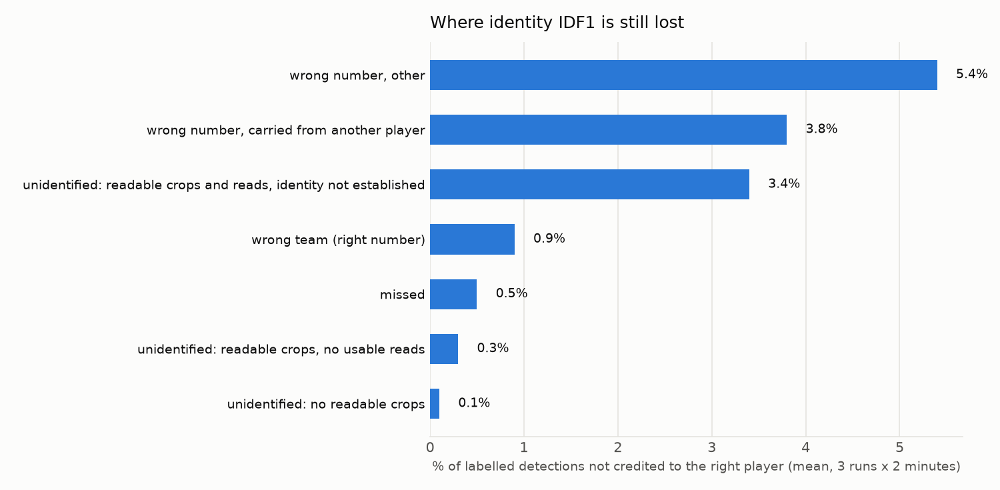
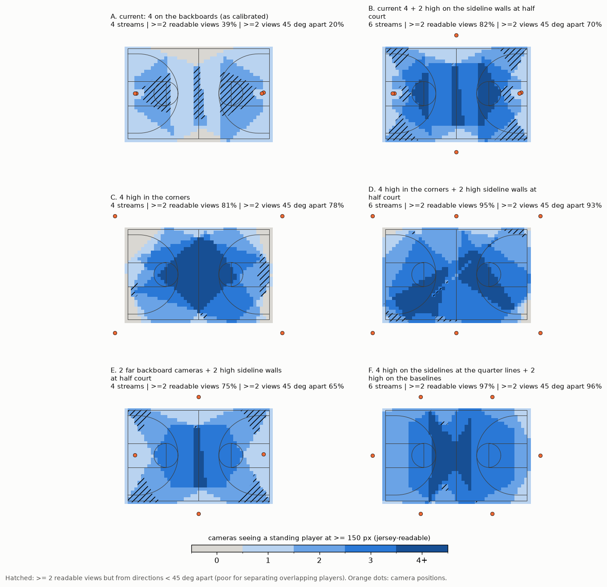

# Multi-camera basketball player tracking: Phase 7 report

Four-camera basketball court, NVIDIA DeepStream 9.1 Multi-View 3D Tracking (MV3DT), evaluated on a Dell XPS 8960
(RTX 3060 Ti 8 GB) with deployment on a Jetson (AGX Orin 64 GB or Orin Nano Super) in mind. Date: 2026-10-29.

This report describes the pipeline's default configuration: INT8 detector, MV3DT's pose model off (section 3), no
display, time-aligned camera streams (section 2.4). It is causal, as it runs live: every input is available while the game is played, and nothing needs an
operator. All results come from DeepStream runs on the final calibration, which places every camera on its physical
mount (section 5). The main results come from three runs with the court tracker running live inside DeepStream, in
C++ (`npct_r1`-`r3`, section 4.5). Three more runs (`np_r1`-`r3`) ran the same pipeline without it; the court
tracker's Python reference was run on their output for the detailed analyses (sections 4.2-4.4). All court-tracker
figures are regenerated with the final code by `scripts/phase8_reevaluate.sh`. Comparisons made before the pose model
was turned off (sections 2.4, 4.8, 6.1) keep their earlier runs, and say so.

## 1. Summary

**Recommendation.** Use DeepStream for detection, per-camera tracking and jersey reading, on time-aligned camera
streams. Run the *court tracker* developed here inside the same pipeline (C++ probe after the jersey reader) and
report each player by identity (team + jersey number), not by track ID.

| What is reported | Identity IDF1 (3 DeepStream runs x 2 labelled minutes) |
|---|---|
| **Player identities, live from DeepStream** (court tracker in C++ inside the pipeline, section 4.5) | **84.3 % (74-94 %)** |
| The same on the held-out minute 5:00-6:00 (used for no setting) | 90.6 % (89-92 %) |
| Court tracker's Python reference on the output of 3 other DeepStream runs (section 4.2) | 84.4 % (72-96 %) |

IDF1 here is the share of labelled detections that end up on the output unit matched to the right player. It's
measured on hand-labelled ground truth (section 2.3). For reference, MV3DT's own global IDs, as DeepStream delivers
them, score 59.6 % (55-64 %) on runs `np_r1`-`r3`.

- **Speed on the 3060 Ti:** the full pipeline, court tracker included, runs at 145-154 fps per camera with its
  evaluation logs (real time is 30); 157-162 fps without the court tracker. Inside the pipeline the court tracker
  takes 0.2 ms per frame (section 4.5); its C++ and Python versions give identical output (section 4.6).
- **MV3DT's pose model is off (section 3):** with it off the pipeline runs 1.6 times as fast, at the same or better
  accuracy, and the seated-spectator rule keeps working (GitHub issue #5).
- **Running live inside DeepStream (section 4.5):** the C++ court tracker and the automatic team model send one Kafka
  message per frame with every player's identity and court position.
- **The camera streams must be time-aligned (section 2.4).** The recordings started up to 0.87 s apart. Aligning them
  raised identity accuracy (Python reference) from 80.5 % to 85.6 % and MV3DT's own from 55.4 % to 61.2 %; with the
  offsets doubled the court tracker fell to 77.7 % (runs made with the pose model on). A live system must align the
  streams by timestamp.
- **No operator:** the two teams are found automatically from torso colour as the game runs and named A and B. From
  2:00 to the end of the game, no crop got the other team's name in any of six runs (section 4.4). Each camera's
  position correction is measured once at installation.
- **Seated spectators are dropped before tracking (section 4.7):** 4 % of their detections reach the output, none
  with an identity, while all but 0.7 % of player detections do.
- **Still not good enough for reliable per-player statistics.** About 16 % of player time is credited to the wrong
  player or no player. Most of that is a *wrong* identity (about 11 %), not a missing one (about 5 %; section 4.2).
- **Results vary from run to run.** Repeated DeepStream runs of the same configuration give different MV3DT IDs and
  jersey reads. Per-minute identity IDF1 ranges from 72 % to 96 %, so every number here is an average over three runs.
- **MV3DT against a plain 2D tracker (section 4.8):** with ByteTrack per camera in its place, on the same detections
  and with the same court tracker, end-to-end identity accuracy fell from 83.6 % to 78.6 % (held-out minute: 82.2 % to
  73.7 %), mostly because ByteTrack drops 4 % of the people MV3DT keeps (runs made with the pose model on).
- **Detector threshold (section 6.1):** INT8 with a detection threshold of 0.1 instead of nvinfer's default 0.2
  detects 97.2 % of labelled people instead of 94.2 %, for 77.5 % end-to-end identity accuracy instead of 74.6 %
  (measured with the jersey reader's previous crop scaling).
- **Jetson (estimated from these measurements, section 6.2):** four cameras at 30 fps look feasible on an AGX Orin
  64 GB. On an Orin Nano Super they don't at 30 fps, but four cameras at 15 fps now look feasible.
- **Camera placement (section 7):** moving the same four cameras from the backboards to high corner mounts would
  raise the share of the play seen by two cameras at jersey-readable size, from clearly different directions, from
  22 % to about 86 %, while framing both baskets for highlight clips (simulated). Six high wall cameras would reach
  99 % with two highlight views per basket; at 30 fps they would be borderline on an AGX Orin by these estimates.

## 2. Setup

### 2.1 Hardware and software
- Ubuntu 24.04, RTX 3060 Ti 8 GB, driver 580, Docker with the NVIDIA Container Toolkit.
- DeepStream 9.1: container `nvcr.io/nvidia/deepstream:9.1-triton-multiarch`, repo `NVIDIA/DeepStream` tag
  `v9.1.0.2`, app `deepstream-test5-app` with a small patch (court filter, torso objects, jersey log, court tracker).
- Brokers: mosquitto (MQTT, inter-camera tracker messages) and Kafka 4.2.0 (MV3DT metadata).

### 2.2 Cameras and video
- **Mounting:** two camera pairs, each on one apparatus on top of a backboard, 6-10 in apart. NL + FR sit at the left
  end, NR + FL at the right end. The N cameras look steeply down at the near half; the F cameras look across at the
  far half.
- **Video:** the cameras record 4K; this pipeline uses 1920 × 1080, 30 fps, undistorted transcodes of about 15
  minutes, cut so that the four streams are time-aligned (section 2.4). **0:00-6:29 is a game** (red vs maroon,
  2 referees); after that comes a warm-up, which is out of scope. Times in this report are those of the NL video.
- **NL lost packets:** six times during the game (0:48-5:22), NL's 4K stream lost a packet, which leaves about 0.9 s
  of grey, undecodable frames each time in the transcode (about 5 s of the game in total).
- **Calibration:** one 3 × 4 projection matrix per camera, in metres with the origin at centre court, fitted with the
  cameras on their mounts (section 5).

### 2.3 Ground truth
Two labelled minutes of the game: 2:00-3:00 and 4:00-5:00. Each has 30 moments, 2 s apart. Every person on court was
labelled at each moment, giving about 380 labelled groups per minute. About 325 and 343 detections per minute carry
a full identity, across about 10 people per minute (players from both teams, including substitutes).

- **Labelling:** done by the user on a web page, with the tracker's guess shown but not counted.
- **Scoring:** labels attach to detection keys (frame, camera, box), so any tracker that uses the same detections can
  be scored. They carry over to new DeepStream runs by box overlap, with each camera's frame offset applied
  (`tools/gt_eval.py`).
- **Refs:** both referees were labelled only as "ref", so referees aren't scored.
- **Limit:** both minutes have been used for development decisions.
- **Held-out minute:** 5:00-6:00 was labelled afterwards the same way (30 moments, 424 detections with a full
  identity, 8 people) and is used only to check results, never to tune (section 4.2).

### 2.4 Time alignment of the camera streams

The clips used in this report are time-aligned: frame n of every camera shows the same moment. The four cameras were
recorded over RTSP into separate files, and the original recordings started up to 0.87 s apart.

**How the offsets were measured** (`tools/sync_check.py`, GitHub issue #3):
- **Camera shake:** a ball hitting a backboard shakes both cameras on that mount at the same moment. The global image
  shift between consecutive frames, cross-correlated between the two cameras on a mount, gives NL-FR 26 frames (two
  hits) and NR-FL 9 frames (two hits).
- **Ball-rim contact:** the two mounts are linked by a ball entering the left rim, matched frame by frame in NL and FL
  (13 frames). A right-rim contact seen by NR and FR confirms the chain (4 frames, as predicted).
- **No drift:** the offsets are the same at 2:13, 4:30, 5:24 and 6:07. Each camera's own timing is intact (NR records
  at 29.83 fps, the others at 30.00; the transcodes place frames by timestamp, so NR stays in step).
- **Not usable:** matching the players' own motion between cameras gives biased offsets, because position errors
  that depend on running direction look like time shifts. Only image events are used.

**Why it matters.** MV3DT associates people across cameras by comparing their positions at the same frame number,
and the court tracker fuses the cameras' floor positions frame by frame. With the streams out of step, both compare
different moments. Players move at a median 0.8 m/s (2.1 m/s at the 90th percentile; court-tracker positions of
js_r1), so 433 ms apart puts the same player a median 0.36 m apart in two cameras (0.92 m at the 90th percentile).
The court tracker merges two tracks fed by different cameras only if they stay within 0.9 m. The same INT8 pipeline
was run on the original clips, on the aligned ones, and on clips with the offsets doubled (`tools/sync_eval.py`,
`reports/sync_eval.md`). All of these runs were made before the pose model was turned off (aligned: `js_r1`-`r3`):

| Clips | Largest offset between cameras with overlapping views | Runs | Court tracker identity IDF1 | End-to-end | MV3DT's own IDs | Foot-point distance, same person and frame (NL-FR / FL-FR / NL-FL) |
|---|---|---|---|---|---|---|
| **Aligned** | 0 | 3 | **85.6 %** (73-96 %) | **83.6 %** | 61.2 % | 0.21 / 0.27 / 0.45 m |
| Original | 433 ms (NL-FL, FL-FR) | 3 | 80.5 % (70-88 %) | 78.6 % | 55.4 % | 0.64 / 0.45 / 0.60 m |
| Offsets doubled | 867 ms (NL-FL, FL-FR) | 1 | 77.7 % (72-84 %) | 75.7 % | 54.9 % | 0.61 / 0.62 / 0.70 m |

**Tolerance.** With up to about 0.4 s between cameras that see the same area, the court tracker lost about 4 points
of identity accuracy and MV3DT about 6; at about 0.9 s the court tracker lost about 7. The court tracker tolerates
offsets better than MV3DT because identities rest mostly on jersey numbers and team colour, which each camera
supplies on its own; positions, speeds and distances, however, are averaged across cameras that show different
moments. Differences of 2-3 points are at the edge of the run-to-run spread, and the doubled-offset case is a single
run. The three runs on the original clips didn't shut down at the end of the clips: those clips differ in length (NL
26,997 frames, FR 26,970), and MV3DT waits for the other cameras' frames for NL's last frames, so NL's end of stream
never arrived (issue #7). All frames of the game were processed; the runs were stopped after their recordings were
complete, so their speed isn't reported. The aligned clips are cut to the same length (26,940 frames each) and the
run script now refuses clips of unequal length.

**How the pipeline aligns them now, and what a live system needs.** Here the alignment comes entirely from the input
files, cut with the measured offsets. DeepStream's muxer groups one frame per camera into each batch, but with file
sources it simply takes the next frame of each file, without looking at capture time. Live cameras can't be pre-cut:
they need synchronised clocks (NTP or hardware sync), and the muxer must pair frames by capture timestamp, not by
arrival order. That hasn't been built or tested here (section 9).

## 3. Pipeline

1. **Detection:** PeopleNet 2.6.3, INT8 (TensorRT calibration made with the deployment TensorRT version), 960 × 544,
   every frame, batch of 4 cameras, detection threshold 0.1 (section 6.1). Boxes are clustered by NMS (IoU 0.5),
   keeping at most 20 per camera frame; the cap applies before the court filter and keeps out some of the seated
   spectators FR sees (GitHub issue #1).
2. **Court filter** (custom probe): drops detections whose floor point lies outside the court plus 0.75 m (benches,
   crowd, scorer's table).
3. **MV3DT** (NvDCF tracker with the single-view 3D person model, multi-view association over MQTT). Provides
   per-camera tracklets and 3D foot positions.
   - **pose model off** (`PoseEstimator.poseEstimatorType=0`, `POSE=1` in `scripts/run_mv3dt.sh` turns it on): MV3DT
     then uses a fixed-height body model with the head at the box top, instead of estimating each person's height
     with its 3D pose model (BodyPose3DNet, one person per inference, FP16). Off, the pipeline ran 141-144 fps per
     camera instead of 89-91, with the same or better accuracy (end-to-end 81.0 % vs 80.7 % on the tuning minutes,
     88.2 % vs 86.6 % held out), and fewer spectators in the output (3 runs each; GitHub issue #5). At 15 fps it
     explained the extra cost per frame: the pose model ran once per second, twice as often per frame.
4. **Jersey reading** inside DeepStream:
   - torso objects are taken from player boxes at least 150 px tall
   - a text detector (PP-OCRv4 det, 384 × 480) finds text boxes
   - a digit recogniser (PP-OCRv4 rec, 48 × 64) reads 1-2 digit numbers
   - both scale their crops bilinearly (`scaling-filter=1`); nvinfer's default scaled them like nearest-neighbour,
     which gave fewer reads (GitHub issue #2)
5. **Court tracker** (C++ probe inside DeepStream, `apps/courttrack`; Python reference `tools/world_tracker.py`). A
   court-plane Kalman tracker over MV3DT's foot points, fully causal: its output is final as soon as it's made.
   - **camera position bias:** each camera's foot points carry a constant offset (NL −0.25 m and NR +0.25 m along the
     court, FL +0.07 m and FR −0.07 m). It is measured once at installation from detections of the same person in two
     cameras (`tools/calib_bias.py`), stored in each camera's calibration file as `courtTrackerBias_m`, and subtracted
     before tracking. The stored values were measured on two runs (`npcal_r1`, `r2`) that are not used for any result
     here, and must be re-measured whenever the calibration, the detector or MV3DT's body model changes (turning the
     pose model off moved FL and FR by 0.06 m).
   - **seated spectators:** detections whose box bottom and MV3DT foot point disagree in the way seated people do
     are dropped before tracking (section 4.7)
   - **matching:** direction-aware measurement noise and a likelihood cost
   - **identity cues:** team colour from the online team model (below) and jersey numbers, where identity = team +
     number
   - **identity output:** an online roster and a per-player appearance model
   - **identity freshness:** identities come from recent reads (10 s), and a track splits when a majority of its
     recent reads show another number
6. **Online team model** (`tools/online_teams.py`, C++ `apps/courttrack/online_teams.cpp`), with no operator:
   - each court track keeps a colour summary (hue x saturation histogram) of its torso crops from FL, FR and NR;
     every 5 s, the summaries of the last 3 minutes are clustered into three groups: two teams and everyone else
   - **first model** (after 30 s): the two clusters whose tracks get the most jersey reads per detection are the
     teams (players' numbers are read, referees' and spectators' hardly ever); before it, no detection has a team
     label
   - **later models** start from the previous centres, and the team names A and B stay with the clusters nearest the
     previous team centres. The read-rate rule decides again only if that match is ambiguous (another cluster within
     twice the squared distance), which didn't happen during the game after the first model in any run here. So
     identities (A:23) stay stable, and a change in who gets read (for example livelier spectators near the end of a
     game) can't move a team name to another cluster.
   - everything outside the two team clusters, referees included, gets no team label
   - per-camera colour correction is learned as the game runs
7. **Output:** one JSON message per frame on Kafka (section 4.5).

**Interfaces.** Every interface between these functions is causal: each output for a frame uses that frame or earlier
ones, or inputs fixed before the game (calibration, camera bias, INT8 calibration cache). The exception is the time
alignment, which here comes from cutting the recorded files (section 2.4). Only PeopleNet runs in INT8; the jersey
reader's two models run in FP16 (section 8). The web version of this report shows the interfaces as an interactive
matrix.

<!-- interface-matrix -->

## 4. Results

### 4.1 Speed (RTX 3060 Ti)

| Run | fps per camera | GPU use (median) | GPU memory peak |
|---|---|---|---|
| np_r1 | 161.8 | 99 % | 1.51 GB |
| np_r2 | 159.8 | 99 % | 1.40 GB |
| np_r3 | 156.6 | 97 % | 1.43 GB |

No display or annotated video (`reports/deploy_variants_detection.md`). With the court tracker running inside the
pipeline and its evaluation logs written to this PC's hard disk: 144.9-154.4 fps per camera (section 4.5). With the
pose model on, the same pipeline ran at 89-95 fps and peaked at 2.35 GB of GPU memory.
- **Jersey reader, per crop:** text detector 0.36 ms, recogniser 0.16 ms (TensorRT FP16).
- **Court tracker:** 0.21-0.22 ms mean per frame inside the pipeline, in C++ (section 4.5); 0.08 ms replayed alone
  on one core of an i7-13700, and 2.1 ms for the Python reference (section 4.6).

### 4.2 Accuracy

| 3 runs x 2 labelled minutes | Live in DeepStream (C++, `npct_r1`-`r3`) | Python reference (`np_r1`-`r3`) |
|---|---|---|
| Identity IDF1 | **84.3 %**; per run and minute 94, 77, 94, 74, 93, 74 % | 84.4 %; 96, 74, 96, 72, 94, 75 % |
| End-to-end (correctly identified / all labelled detections) | 82.1 %; 97.4 % of labelled people detected | 82.2 %; 97.4 % detected |
| Identity switches per labelled minute (mean) | 37 | 37 |
| **Held-out minute 5:00-6:00**, identity IDF1 | **90.6 %** (89, 91, 92 %) | 90.8 % (90, 91, 92 %) |
| Held-out minute, end-to-end | 89.0 %; 98.2 % detected | 89.5 %; 98.6 % detected |

The two columns are different DeepStream runs, so their gap is within the run-to-run variation (below). The live
column is the pipeline's output as recorded; replaying its recorded inputs with the C++ and the Python court tracker
reproduces it exactly (section 4.6).

**Identity rules (issue #11).** Two rules decide a track's identity: jersey reads with a recogniser score below 0.8
count a quarter (on the labelled moments they are 74 % correct, the others 96-100 %), and the identity's team comes
from the track's colour labels of the last 3 s, so a swap with a player of the other team shows within seconds. They
were chosen on the two tuning minutes over 7 DeepStream runs (+1.6 points identity IDF1, 8 run-minutes better, 2
worse; `tools/id_explore.py`) and then checked once on the held-out minute: +0.8 points, 6 of 7 runs better. Faster
read decay, other split rules, a stricter roster, doubting identities after close encounters and the encounter
swap check all scored the same or worse.

The held-out minute was labelled after all other settings in this report were chosen and was used for none of them.
Turning the pose model off was decided on all three minutes together (section 3).

The loss breakdown below is for the Python reference runs.



- **Wrong number, other (5.3 %):** misreads, and identities established from too few reads.
- **Wrong number carried over from another player (5.1 %):** a track swaps players and keeps the old identity until
  enough new reads arrive. Reads are sparse: a given player is read only every few seconds.
- **Unidentified (4.0 %):** almost all of it (3.7 %) on tracks with readable crops and reads that never reached an
  identity.
- **Missed by the tracker (0.7 %):** small; part of it is the seated-spectator rule (section 4.7). Detection and court
  filtering aren't the bottleneck.
- **Wrong team with the right number (0.5 %):** on the numbers both teams wear (1 and 3).

**Run-to-run variation.** Repeated DeepStream runs of the same configuration detect nearly the same boxes (97.6-98.3 %
of one run's boxes are found again in another, `reports/deploy_variants_detection.md`), but the MV3DT IDs, per-camera tracklets and the jersey reads attached
to them come out differently, most likely because the order in which cameras exchange tracker messages varies. Every
number here is therefore a mean over three runs.

### 4.3 Where on the court


Over the whole game (np_r1, `reports/court_heatmap_zones.txt`):

| Zone | New identities per player-minute | Tracks lost per player-minute | Time with a duplicate track |
|---|---|---|---|
| Interior | 1.0 | 1.5 | 1.8 % |
| Within 1.5 m of a sideline | 3.4 | 7.6 | 0.6 % |
| Within 1.5 m of a baseline | 4.4 | 4.7 | 0.2 % |
| Left-end third | 1.3 | 2.1 | 2.3 % |
| Right-end third | 1.4 | 2.1 | 1.1 % |

- **Lines:** tracks are lost three to five times as often near the lines as in the interior. Players leave the court
  there, and often only one camera sees them.
- **Ends:** the two ends are similar in new identities and lost tracks; the left end has more time with a duplicate
  track.

### 4.4 Team labels

The online team model's labels were checked crop by crop over the whole game against reference colour labels (a
colour clustering of the whole game with clusters named by hand, used only for this check; `tools/team_label_check.py`,
`reports/team_label_check.txt`). Six runs: the three main runs and the three `npct` runs (Python reference).

- **Teams:** maroon was A and red B in every run.
- **First minute:** no labels before the first model at 0:30. Between 0:30 and 1:00, 11-13 % of red crops were
  labelled A; from 1:00 to 2:00, none.
- **2:00 to the end of the game (6:29):** no crop got the other team's name, and at most 9 referee crops per run got
  a team label.
- **Unchecked:** the model also gives team names to about 4,900-5,800 crops per run that the reference left
  unlabelled, mostly A. It hasn't been checked whether those are players or people beside the court.
- **Assumption:** the first model's read-rate rule assumes players' numbers are read clearly more often than anyone
  else's shirt in the first 30 s of a game. On the earlier runs with the pose model on, from 2:00 to the end of the
  game the team clusters got reads on 2.5-5.4 % of detections, the third cluster on a median of 0.9-2.3 % per run. In three runs the third cluster's highest rate
  (3.0-3.3 %) briefly exceeded a team cluster's lowest; the rule isn't applied again after the first model, so this
  didn't move a team name.

### 4.5 Running inside DeepStream

The court tracker runs live in the pipeline (`scripts/run_mv3dt.sh` with `COURTTRACK=1`; probe
`apps/courttrack/courttrack_probe.cpp`, after the jersey reader):

- **Inputs:** MV3DT's world foot points, the court filter (0.3 m margin), the stored camera bias, the jersey reads of
  the same frame, and torso colour histograms. Every 3rd frame, the torso of each good crop (FL, FR, NR) is cut out of
  the frame with NVIDIA's `NvBufSurfTransform` into a 32 × 48 tile and its hue x saturation histogram computed on the
  CPU. This works the same way on a Jetson.
- **Processing:** once all four cameras of a frame have arrived, the online team model labels the crops, the court
  tracker steps, and the team model learns from the tracker's assignment.
- **Output:** one JSON message per frame on its own Kafka topic (`courttrack`) with, per player: court track id,
  identity (e.g. `A:23`) and team, position and velocity on the court, whether it was seen this frame or predicted,
  how many cameras saw it, and the detections it came from (camera + MV3DT object id). The per-camera messages are
  unchanged. Consumers should key on the track id: a track's identity can change (when first established, or after
  a swap is detected), and a briefly unseen player is kept with a predicted position for up to 2 s.
- **Logs for evaluation:** the identity of every detection (CSV) and the tracker's inputs, which `ct_replay` and the
  Python reference can replay.

**Checked on three full-game runs** (`npct_r1`-`r3`, `reports/courttrack_live.txt`):

| | Result |
|---|---|
| C++ and Python replays of the recorded inputs | identical to each other and to the live output (all of about 527,100-527,300 detection identities per run) |
| Identity IDF1, live | **84.3 %** (74-94 %); end-to-end 82.1 % (97.4 % of labelled people detected) |
| Python reference on the same runs (Kafka output, OpenCV histograms) | 85.2 % |
| Pipeline speed with the court tracker | 144.9-154.4 fps per camera, with the evaluation logs written to this PC's hard disk |
| Court tracker + team model, in the pipeline | 0.19-0.27 ms mean, 1.5-2.0 ms p99, 10-14 ms max per frame |
| Torso histograms, in the pipeline | 2.3 ms mean per four-camera batch (every 3rd frame) |
| Kafka messages | 26,935 per run, none failed |

- **Live vs Python reference:** 84.3 % against 85.2 %; 4 run-minutes within 1 point, 2 worse by 1.8 and 4.1 points.
  The live pipeline computes the torso histograms differently (NV12 frames scaled to small tiles, against OpenCV on
  full-resolution frames); the team model learns from whichever it gets.
- **Duplicate ids:** MV3DT occasionally gives two different people the same object id in one camera and frame.
  Everything downstream is keyed by (frame, camera, id), so only the first is kept.

- **Speed in the pipeline:** 0.2 ms per frame against 0.08 ms replayed alone (CPU shared with DeepStream's threads).
  The slowest frames are the team model's re-clustering (every 5 s, on the probe's streaming thread). Time per frame
  follows the number of people: highest in the warm-up after the game. Finished tracks that no re-link can pick are
  dropped as the game goes (`Tracker::prune`, identities unchanged), so memory stays bounded.
- **Logging:** the evaluation logs are written to this PC's hard disk, which stalls at times; they would be off in
  deployment.

### 4.6 C++ port of the court tracker: replay check

`apps/courttrack` is a C++ port of the court tracker (`courttrack.cpp`) and of the online team model
(`online_teams.cpp`), for use inside the DeepStream pipeline. Both were checked by replaying the exact per-frame
inputs recorded in the live runs (`apps/courttrack/ct_replay` and the Python reference, `tools/courttrack_export.py
live`):

- **Same output:** on `npct_r1`-`r3`, the C++ and the Python replays reproduce all of about 527,100-527,300 live
  detection identities per run (the whole recording). This needs the colour statistics summed in a fixed order, fused
  multiply-add disabled in the C++ builds (`-ffp-contract=off`, which matters on the Jetson's ARM CPU) and NumPy's
  percentile formula matched exactly.
- **Speed:** 0.08 ms per frame on one core of the i7 (replay of `npct_r1`), against 2.1 ms for the Python version
  (measured on an earlier live run). The slowest frames, 3.3-6.7 ms, are mostly the team model's re-clustering every
  5 s.

### 4.7 Seated spectators

The labels include crops of people who aren't players (331 detections in the three main runs). Almost all of them are
spectators in the front-row seats, seen by FR, which looks across the court at them (`tools/nonplayer_eval.py`,
`reports/nonplayer_output.md`).

- **The problem:** their boxes end at the line, so the court filter keeps them. MV3DT's body model assumes a standing
  person, so it places their feet about 2 m inside the court, among the players, where they could take players'
  identities.
- **The rule:** for a seated person, the box bottom projected onto the floor lands at their seat, at or just outside
  the line, while MV3DT puts the feet 2 m further in. For players the two agree closely. A detection is dropped
  before tracking when its two foot points are more than 1 m apart *and* its box-bottom point is less than 0.6 m
  inside the lines (boxes cut by the bottom image edge are never dropped). On the labelled detections of the main runs,
  without the rule 91 % of the spectators' detections reach the output and 34 % get an identity; the rule drops 0.7 %
  of the players'. No pose model is needed; both points are already available, in Python and in the DeepStream probe,
  and MV3DT's fixed-height body model (pose model off) places seated people's feet inside the court just the same.

| Labelled detections | Spectators in the output | Spectators with an identity | Players in the output |
|---|---|---|---|
| Python reference (main runs) | 4 % (12 of 331) | 0 % (0) | 99.3 % |
| Live in DeepStream (`npct` runs) | 4 % (12 of 329) | 0 % (0) | 99.3 % |

The rule's thresholds were set on this venue's front row and should be checked at other venues.

### 4.8 MV3DT against a 2D per-camera tracker (ByteTrack)

How much of the result is MV3DT's doing? A widely used alternative is a 2D tracker per camera, such as ByteTrack
(usually paired with a YOLO detector; YOLOX-m INT8 scored lower than PeopleNet here, issue #10). It does detection
association within one camera only: no 3D body model, no cross-camera fusion, no jersey reading or identities. To
compare the trackers alone, ByteTrack (`tools/bytetrack.py`, re-implemented from the authors' code with their default
settings) replaced MV3DT on the same detections: runs `bt_r1`-`r3` (default configuration) logged every PeopleNet box
the court filter passed to MV3DT. Each camera's ByteTrack boxes went to the court tracker with their bottom centre
projected onto the floor as the foot point. Jersey reads, made by DeepStream on MV3DT's boxes, were attached to the
ByteTrack box overlapping each read box (96 % of read attempts found one). Torso colours were taken from the
ByteTrack boxes. Everything else is the default configuration of the time, with the pose model on (issue #12).

| 3 runs, same detections | MV3DT + court tracker | ByteTrack + court tracker |
|---|---|---|
| Identity IDF1, tuning minutes (2:00-3:00; 4:00-5:00) | **85.3 %** (96, 96, 93; 77, 73, 76 %) | 83.4 % (86, 87, 87; 79, 79, 83 %) |
| End-to-end, tuning minutes | **83.6 %**; 98.0 % of labelled people detected | 78.6 %; 94.2 % detected |
| Identity switches per labelled minute | 32 | 52 |
| Held-out minute 5:00-6:00, identity IDF1 | **83.9 %** (86, 84, 82 %) | 79.1 % (81, 78, 78 %) |
| Held-out minute, end-to-end | **82.2 %**; 98.0 % detected | 73.7 %; 93.2 % detected |

- **MV3DT is worth about 5 points end-to-end on the tuning minutes and 8 on the held-out minute.** Most of it is
  people with no box: every labelled person on these runs had a PeopleNet detection, but ByteTrack output no box for
  4.4 % of them. It starts tracks only from detections above 0.6 and drops tracks that lose their detections; MV3DT most likely keeps
  them through the other cameras' views and its own predictions.
- **ByteTrack's per-camera tracks break more often** (2,800 tracks over the four cameras), which the court tracker
  partly absorbs. On the busy minute 4:00-5:00 its identity IDF1 was higher than MV3DT's in all three runs, so the
  court tracker, not MV3DT, does most of the identity work there.
- **ByteTrack's own threshold:** 0.4 and 0.3 (PeopleNet's scores run lower than YOLOX's) scored 81.4 % and 79.3 %
  identity IDF1 on the tuning minutes, against 83.4 % at the default 0.5: more short tracks on spectators.
- **What it lacks besides accuracy:** no 3D foot point, so people whose feet are cut off by the image edge (6.6 % of
  its boxes) are placed too far from the camera, and the seated-spectator rule (section 4.7), which compares MV3DT's
  3D foot point with the box bottom, can't work.
- **Where it matters:** a JetPack 6 device can run DeepStream 7.1 at most, without MV3DT (section 6.2). A per-camera
  tracker with this court tracker on top is the option there, at about the accuracy above. ByteTrack itself is cheap
  (under 0.5 ms per camera frame in Python on this PC).
- **Caveat:** the labels sit on MV3DT boxes of run `js_r1`, carried to each run by box overlap; MV3DT's held-out score
  on these three runs (83.9 %) is lower than on the earlier live runs with the pose model on (88.4 %), which is
  run-to-run variation.

## 5. Calibration

The final calibration places each camera where it physically is: the pairs on their backboard apparatus.

- **Line tracing:** each camera's court lines were re-traced automatically from a player-free median image
  (`tools/court_refine.py`). This replaced hand-traced lines; on FL those had followed the lettering and the logo
  instead of the paint, and its overlay was visibly rotated (spotted by the user).
- **Joint fit on the mounts** (`tools/calib_mount.py`): all four cameras are fitted together, with each far camera
  held within 0.25 m per axis of its partner (FL with NR, FR with NL) and the standard HS/NCAA markings. The court's
  length and width are fitted.

| Camera | Court-line fit error | Position (x, y, z), m | Distance to partner |
|---|---|---|---|
| NL | 1.75 px | (−9.41, 0.05, 3.81) | — |
| FR | 1.88 px | (−9.66, 0.02, 4.06) | 0.35 m to NL |
| NR | 2.28 px | (9.57, 0.02, 4.05) | — |
| FL | 3.02 px | (9.82, 0.19, 4.16) | 0.33 m to NR |

- **The constraint costs little:** fitted without the mount constraint, the errors are 1.68, 1.80, 2.05 and 2.41 px.
  FL's larger error comes mostly from its far sideline, which runs along the edge of its image.
- **Court size:** fitted at 70.3 × 45.1 ft. All tools read it from `tools/court.py`.
- **Single source of truth:** the camera files are in `datasets/gym/camInfo`, including the court tracker's camera
  bias (section 3). Earlier versions are archived beside them, and each run keeps the copy it used in `camInfo_used/`.
- **Independent check:** the 3-point arc (19.75 ft) wasn't used in the fit, yet it lands on the painted arc (FL shown
  below).


**Position consistency between cameras.** For the same labelled person at the same moment, MV3DT foot points from two
cameras differ by a median 0.31-0.32 m per run and minute after the camera bias is removed (9-11 % of pairs over
0.9 m; 1,001 pairs over the three main runs; `tools/xcam.py`, `reports/xcam_np_*.txt`). The error runs mostly along
each camera's line of sight (on np_r1 2:00-3:00, standard deviation 0.26-0.60 m along it per camera, 0.11-0.28 m
across). It comes from estimating feet out of boxes (posture, boxes cut by the frame edge), not from the calibration.

## 6. Deployment options: measured on the 3060 Ti, estimated for Jetson

### 6.1 Measured: INT8 detection threshold

Both thresholds were run three times on the time-aligned clips, without display, and scored on the ground truth.
**End-to-end** counts correctly identified labelled detections over *all* labelled detections, so people the detector
misses count as errors (`reports/deploy_end_to_end.md`, `reports/deploy_variants_detection.md`). These six runs were
made before the jersey crops were scaled bilinearly (section 3) and with the pose model on, so their identity scores
are lower and their speed lower than the main results; the comparison is about detection, which neither affects.

| INT8 detector | fps per camera | GPU use | Labelled people detected | Identity IDF1 (detected) | End-to-end identity |
|---|---|---|---|---|---|
| threshold 0.2 (nvinfer default) | 95.6-96.2 | 88-89 % | 94.2 % | 78.9 % | 74.6 % (56-89 %) |
| **threshold 0.1 (default here)** | 93.8-96.9 | 88-89 % | 97.2 % | 79.6 % | **77.5 %** (67-86 %) |

- **The lower threshold** finds more of the labelled people at the same speed, and the people it adds are identified
  about as well as the rest, so the end-to-end gain (3.5 points) comes mostly from detection.
- **Calibration:** NVIDIA's published INT8 calibration file was made with an older TensorRT (10.3), which names the
  activation layers differently; with it, most layers fell back to full precision. The runs here use a calibration
  made with the deployment TensorRT version (10.16) on 400 frames from the video (`tools/int8_calibrate.py`). A Jetson
  needs a calibration made with its own TensorRT version, and the camera bias re-measured with it (section 3).
- **INT8 accuracy** was checked against FP16 on this pipeline in GitHub issue #1.

### 6.2 Estimated for AGX Orin 64 GB and Orin Nano Super

These are **estimates**: the 3060 Ti measurements scaled by hardware ratios. Nothing has been run on a Jetson.
Device specifications are NVIDIA's published figures as known at the time of writing; check them against current
spec sheets before buying.

| | AGX Orin 64 GB | Orin Nano Super 8 GB |
|---|---|---|
| GPU | 2048 CUDA cores, 64 tensor cores | 1024 CUDA cores, 32 tensor cores |
| Deep-learning accelerators (DLA) | 2 | none |
| AI performance (INT8, sparse, as quoted) | up to 275 TOPS | up to 67 TOPS |
| CPU | 12-core Cortex-A78AE | 6-core Cortex-A78AE |
| Memory / bandwidth | 64 GB, 205 GB/s | 8 GB, 102 GB/s |
| Hardware video encoder | yes | no |
| Hardware decode, H.265 (approximate) | about 7 × 4K30 or 22 × 1080p30 | about 2 × 4K30 or 11 × 1080p30 |
| Power | 15-60 W | 7-25 W |
| Price (developer kit, approximate) | about US$2,000 | about US$250 |

**Assumed relative speed on this workload:** the Orin Nano Super 5-8 times slower than the 3060 Ti, the AGX Orin
64 GB 2.5-3.5 times slower (twice the Nano's GPU cores and memory bandwidth). The 3060 Ti figures are the main runs
(section 4.1, 157-162 fps per camera, GPU 97-99 % busy).

| Configuration (INT8, detector every frame, pose model off, no display) | 3060 Ti (measured) | AGX Orin 64 GB (estimate) | Orin Nano Super (estimate) |
|---|---|---|---|
| fps per camera with 4 cameras at 30 fps | 159 | **45-64** | **20-32** |
| fps per camera with 6 cameras at 30 fps | 106 | 30-42 | 13-21 |
| fps per camera with 4 cameras at 15 fps (measured: 133-138) | 135 | 39-54 | **17-27** |
| GPU share of one 30 fps camera | 5 % | 12-16 % | 23-37 % |

**What this means:**
- **Orin Nano Super:** four cameras at 30 fps don't look feasible (20-32 fps per camera at best). **Four cameras at
  15 fps look feasible** (17-27 fps per camera, needing 15):
  - **15 fps was measured on the 3060 Ti** (GitHub issue #5; every frame detected, frame-counted settings halved,
    `scripts/phase9_fps15.sh`): with the pose model off, 133-138 fps per camera and end-to-end identity 80.1 % on the
    tuning minutes and 87.0 % held out (3 runs, `r15nopose_r1`-`r3`, made with the camera bias measured with the pose
    model on), against 82.2 % and 89.5 % at 30 fps. MV3DT's own IDs suffer more at 15 fps (53 % vs 62 % with the pose
    model on).
  - The extra cost per frame first seen at 15 fps (74 fps per camera instead of about 90) was the pose model, which
    ran once per second and so twice as often per frame; with it every 2 s the speed came back to 85 fps.
  - Two cameras instead of four were tested offline and dropped: even switching the pair by where play is, 9-10
    points fewer player-moments were identified than with four (issue #5).
- **AGX Orin 64 GB:** four cameras at 30 fps look feasible (45-64 fps per camera).
  - **Six cameras at 30 fps** look borderline (30-42 fps per camera).
  - **Its two DLAs** could take the INT8 detector off the GPU (DeepStream supports this), but their throughput for
    this model must be measured.
  - **4K decoding:** four 4K streams for highlight clips (section 7) are within its decoder, not the Orin Nano
    Super's.
- **Court tracker:** inside the pipeline on the 3060 Ti PC it takes 0.2 ms per frame on average, with p99 about 2 ms
  and occasional frames up to 14 ms (the team model's re-clustering; section 4.5). The Orin's cores are slower, so
  the worst frames need measuring on the device (GitHub issue #6); moving the re-clustering to a worker thread is the
  fix if they approach the 33 ms frame period.
- **Software:** DeepStream 9.1, which this pipeline uses, needs JetPack 7.2 on Orin. MV3DT first appeared in
  DeepStream 8.0, and the newest DeepStream for JetPack 6 is 7.1, so a JetPack 6 device can't run the pipeline. On
  this PC, with MV3DT's multi-view association off (single-view 3D tracking only, as DeepStream 7.1 would offer),
  end-to-end accuracy fell from 82.4 % to 74.0 % (3 runs each, made with the pose model on).
- **Brokers:** MV3DT exchanges messages over MQTT between its per-camera trackers; on a single device the broker runs
  locally. Kafka is only needed if metadata leaves the device.
- **Time alignment:** the streams must be batched by capture timestamp (section 2.4).

**Recommendation.**
- **For four cameras at 30 fps (current or corner layout), choose the AGX Orin 64 GB.**
- **The Orin Nano Super could take four cameras at 15 fps** (estimate above), at about 2 points lower end-to-end
  accuracy than 30 fps on this PC. Its speed ratio is the least certain number here: measure before relying on it.
- **Buy or borrow with JetPack 7.2** (DeepStream 9.1), as above.
- **Before buying, measure on the device:**
  - fps per camera (INT8, no display)
  - DLA throughput (AGX Orin)
  - decode capacity
  - accuracy, re-scored with `tools/multi_eval.py` after re-calibrating INT8 for the device's TensorRT

## 7. Camera placement and quantity

The current cameras sit at backboard height and see players mostly from the side. That is the main reason tracks
swap in close encounters (section 4.2). The 4K streams may also be used to cut highlight clips, so the cameras must
cover where the action happens, not just the floor. This section compares candidate layouts with a camera-layout
simulator (`tools/camera_layout.py`) and sets them against compute.

### 7.1 Method
- **Model:** each camera is a 1920 × 1080 pinhole at a given position, aim point and lens field of view, over the
  fitted court. For each 0.5 m floor cell and a standing 1.8 m player, it computes:
  - which cameras see the whole player
  - the player's height in pixels: at least **150 px is readable** for the jersey reader, at least 80 px detectable
  - how steeply each camera looks down, and the floor length hidden behind a player ("shadow"; shorter means fewer
    occlusions)
  - the largest angle between two readable cameras' viewing directions. At least **45°** apart is needed to
    triangulate positions and separate players who overlap in one view.
- **Where the action is:** every floor cell is weighted by the time players spent there in the game (court-tracker
  positions of js_r1). "Share of the action" counts where play happened; "area" counts the floor equally.
- **Highlight framing:** per basket, a camera frames the scene if players' feet and heads within 3 m of the rim and
  the ball up to 1.5 m above the rim are all in its image. Reported with the rim's width in pixels on the camera's 4K
  frame and the view: end-on (less than 30° from the court's long axis), corner, or sideline (more than 60°).
- **Validation:** for the current cameras, real detection boxes measure 0.89-1.01 times the predicted standing height
  (median per camera, js_r1, game frames; FL lowest). So the model's pixel sizes are realistic, if somewhat
  generous for FL.
- **Choice of lenses and aims:** each new camera's lens (50-95° horizontal) and aim point are chosen by a search that
  maximises the share of the action seen by two readable cameras at least 45° apart, plus a credit for framing each
  basket (and for a second view of it from another direction). Existing cameras stay as calibrated.
- **Venue assumptions, to be replaced by measurements:** walls 2 m beyond the lines, wall mounts up to 6 m high. Room
  dimensions and ceiling height weren't available.

### 7.2 Results



| Layout (mounts 6 m high) | Streams | ≥2 readable views ≥45° apart (area / action) | No readable view (area / action) | Baskets framed for highlights (view, rim width in 4K) |
|---|---|---|---|---|
| A. Current: 4 on the backboards | 4 | 20 % / 22 % | 6 % / 1 % | each by one far camera, end-on, 98-99 px |
| E. Keep the 2 far backboard cameras, move 2 to the sideline walls at half court | 4 | 57 % / 81 % | 3 % / 0 % | each end-on 98-99 px + corner 73-74 px |
| **C. 4 high in the corners** | **4** | **64 % / 84 %** | 5 % / 3 % | each sideline 134-143 px + end-on 69 px |
| B. Current 4 + 2 on the sideline walls at half court | 6 | 61 % / 83 % | 2 % / 0 % | each end-on 98-99 px + corner 74 px |
| D. 4 corners + 2 on the sideline walls at half court | 6 | 85 % / 95 % | 2 % / 1 % | each sideline 134 px + end-on 57-69 px |
| **F. 4 on the sideline walls at the quarter lines + 1 per baseline wall** | **6** | **88 % / 99 %** | 4 % / 0 % | each sideline 121 px + corner or end-on 63-77 px |

The table and figure are regenerated by `python -m tools.camera_layout` into `reports/camera_layouts.md` and
`reports/figures/camera_layouts.png`.

- **Highlights cost some tracking coverage with four cameras:** aimed for tracking alone (no highlight credit in the
  search, `HL_WEIGHT = 0`), the four corner cameras reach 94 % of the action with two well-separated views, but frame
  neither basket; aimed to frame both baskets too, they reach 84 %. With six cameras the cost disappears (layout F:
  99 %).
- **Where the play is, coverage is better than the area figures suggest:** the cells without two good views are
  mostly cells where little play happened.

**Mounting height** (`reports/camera_layouts_height.md`):

| Height | C: ≥2 readable views ≥45° apart (area / action) | C: no readable view (action) | F: ≥2 readable views ≥45° apart (area / action) | F: baskets framed |
|---|---|---|---|---|
| 4.5 m | 73 % / 86 % | 2 % | 93 % / 99 % | each corner 78-79 px + end-on 59-70 px |
| 5 m | 72 % / 86 % | 2 % | 93 % / 99 % | each corner 77-79 px + end-on 59-70 px |
| 6 m | 64 % / 84 % | 3 % | 88 % / 99 % | each sideline 121 px + corner or end-on 63-77 px |
| 7 m | 61 % / 80 % | 3 % | 85 % / 96 % | each sideline 117 px + corner 96 px |

In layout C, every height keeps both baskets framed from a sideline view (128-143 px) and an end-on view (60-69 px).

- **Lower mounts:** players appear larger, so slightly more of the court is readable.
- **Higher mounts:** steeper views, which shrink the area hidden behind each player.
- **For the corner layout, about 4.5-5 m is the best balance:** 86 % of the action seen by two well-separated cameras,
  2 % unreadable, both baskets framed from two directions.

### 7.3 Compute per camera stream

| Platform (INT8 detector every frame, no display) | GPU per 30 fps stream | 4 streams | 6 streams |
|---|---|---|---|
| RTX 3060 Ti | about 5 % (measured) | about 19 % | about 28 % |
| AGX Orin 64 GB | about 12-16 % (estimate) | about 46-65 % | about 69-97 % (borderline) |
| Orin Nano Super | about 23-37 % (estimate) | about 92-148 % (not feasible) | not feasible |

- **Basis:** the main runs (157-162 fps per camera at 97-99 % GPU use, pose model off, section 4.1). The estimates assume
  the AGX Orin 64 GB is 2.5-3.5 times slower and the Orin Nano Super 5-8 times slower. Neither assumption has been
  measured.
- **DLAs:** on the AGX Orin, running the detector on its DLAs would free GPU time; not measured yet (GitHub issue #4).
- **Jersey reading** scales with the number of readable players rather than cameras. More cameras can be held to the
  same read budget.
- **Inter-camera tracker messages** (MQTT) grow with the number of camera pairs. Six cameras is modest.
- **The cameras already record 4K;** this pipeline uses a 1080p transcode. The detector runs at 960 × 544 either way.
  Feeding the 4K streams costs mainly decoding (about 4× the decode work); highlight clips need the 4K recordings,
  jersey reading doesn't.
  - **Coverage:** with the current cameras, the simulator shows readable coverage unchanged (94 % of the court by at
    least one camera). Wherever a camera sees a player at all, the player is already at least 150 px tall at 1080p.
  - **Reads (measured offline, GitHub issue #2):** the jersey reader was replayed outside DeepStream on the main
    runs' own boxes, with torsos cut once from the 1080p frames and once from the matching 4K frames at twice the
    resolution (`tools/hires_jersey.py`). With the same smooth scaling for both, the 4K crops gave 6 % fewer reads at
    the same share of misreads, and a lower court-tracker identity score (79.2 % vs 84.0 %, 3 runs × 2 minutes).
    Reading jerseys from 4K is therefore not pursued.

### 7.4 Proposal
1. **Same compute as today (4 streams): move to layout C, four corner cameras at about 4.5-5 m.**
   - Lenses and aims as chosen by the search (about 60-70° horizontal at 6 m), so that each basket is framed side-on
     from its near corner and end-on from a far corner.
   - The share of the action seen by two well-separated readable cameras rises from 22 % to about 86 %, and both
     baskets are framed for highlight clips from two directions (rim about 140 px wide from the sideline, 60 px
     end-on, in 4K).
   - Views become steeper (median look-down 15° → 20-22°), and the area hidden behind players shrinks from about 9 m
     to about 6 m.
   - With four streams it needs an AGX Orin 64 GB at 30 fps (section 6.2).
2. **If six streams are affordable, use layout F:** four sideline cameras at the quarter lines plus one per baseline,
   at 4.5-5 m: 99 % of the action covered, both baskets framed from two directions. Six streams at 30 fps are
   borderline on an AGX Orin's GPU by the estimates in section 6.2; its DLAs could take the detector (untested).
3. **If cameras can't move:** keep the far backboard cameras and move the two near ones to the sideline walls at half
   court (layout E, still 4 streams): 81 % of the action, and the backboard cameras keep the best end-on basket views
   (rim about 98 px).
4. **Whatever the layout:**
   - use identical cameras with locked exposure and focus, recording 4K for clips
   - synchronise the cameras' clocks and batch the streams by timestamp (section 2.4)
   - avoid pointing at windows or bright lights
   - calibrate with the mount positions as a constraint, as in section 5, ideally with measured court dimensions

**Caveat.** These are geometric coverage figures, not tracking accuracy or clip quality. Before buying hardware, the
best check is a temporary installation (stands or poles at the corners) for one session, run through the same
pipeline and scored on newly labelled ground truth.

**How the professional systems compare** (general knowledge, not verified here):
- **Basketball:** NBA optical tracking (SportVU, Second Spectrum, now Hawk-Eye) uses many fixed cameras high in the
  arena rafters.
- **American football:** the NFL uses RFID chips in the shoulder pads.
- **Identity:** in all of these, operators assign identities, correct swaps live and review data after games, with
  rosters and substitutions from official feeds.
- **What this means here:** high mounts and roster and substitution input are the parts worth borrowing; both fit this
  project's real-time setup.

## 8. Limitations

- **Small ground truth:** two minutes of one game on one court, with 10 players and refs not scored.
- **Held-out data is one minute:** both tuning minutes informed development decisions, including the online team
  model's settings. The held-out minute 5:00-6:00 (90.6 % identity IDF1 live) is untouched by tuning but is a single
  minute of the same game.
- **Run-to-run variation:** per-minute identity IDF1 ranges from 72 % to 96 % across DeepStream runs. Three runs
  narrow it, but differences under about 2 points aren't reliable.
- **Sensitivity:** tracking decisions amplify tiny input changes (a few centimetres of camera bias, a few hundred
  duplicate detections in a game), which shows up as run-to-run spread.
- **One game, one venue:** the online team model, the roster inferred online and the seated-spectator rule's
  thresholds are tested on this one game. Other courts, lighting and kits are untested.
- **Time alignment:** the offsets were measured on this recording. A live system must keep the streams aligned by
  timestamp; the tolerance in section 2.4 rests on three runs per setting and one run with doubled offsets.
- **Court size and venue:** the court's length and width are fitted, not measured. The camera-placement study assumes
  wall distances and mounting heights.
- **Earlier runs:** the time-alignment comparison (2.4), the ByteTrack comparison (4.8), the detection thresholds
  (6.1) and the 4K jersey replay (7.3) were measured with the pose model on; each compares runs made alike.
- **Other models in FP16:** the jersey reader's text detector and recogniser run in FP16 (section 4.1), not INT8.
  INT8 was tested on the live pipeline, one run each. The calibration used 512 torso crops and 2,048 text boxes cut from
  np_r1, spread over the whole recording, with TensorRT entropy calibration (as for PeopleNet).
  - **Both models in INT8:** 65 % fewer digit reads; identity IDF1 62.6 % on the tuning minutes and 78.6 % on the held-out
    minute.
  - **Text detector only in INT8:** 14.5 % fewer digit reads (10,918 against 12,717-12,846 in npct_r1-r3); identity IDF1
    81.7 % on the tuning minutes and 89.5 % on the held-out minute, against 84.3 % and 90.6 %. 158 fps against 142-154 fps.

## 9. Next steps (prioritised)

1. **Measure on the target Jetson (AGX Orin 64 GB, or Orin Nano Super at 15 fps).**
   - Re-calibrate INT8 for its TensorRT version and re-measure the camera bias (README, "INT8 on a new device").
   - Build and test pairing the live camera streams by capture timestamp (section 2.4; the clips here were
     pre-aligned).
   - Measure fps per camera without display, and DLA throughput (AGX Orin; issue #4).
   - Measure the court tracker's worst-frame time in the pipeline; move the team model's re-clustering to a worker
     thread if it exceeds the frame period (issue #6).
   - Live streams don't end together like files: check what MV3DT does when one camera stops sending (section 2.4:
     with files of unequal length, it waits for that camera's frames indefinitely; issue #7).
   - Re-score accuracy with `tools/multi_eval.py` and `tools/courttrack_export.py live`.
2. **Trial the corner layout (C) for one session** (issue #9) with temporary mounts at about 4.5-5 m, label a minute
   and compare with the current layout, including the highlight framing of both baskets.
3. **Identity logic** (issue #11). The largest remaining loss is a wrong number on the same team when the true
   number hasn't been read for 10 s (about 5 % of labelled detections); colour can't separate those players. More
   reads don't help (issue #8: reading every frame scored the same).
4. **Use the official roster** (numbers per team, available for real games): reject reads of numbers on neither
   roster, and settle the team of a number only one team wears. The roster can't say which colour is which team, but
   the tracker can learn that from which numbers each colour cluster is read with. This also targets the wrong-team
   errors on shared numbers.

## 10. How to reproduce

```bash
./scripts/brokers.sh start
python -m tools.make_clips --start 0 --seconds 898 --offsets NL=26,FL=13,NR=4 --name gym_sync   # aligned clips
for r in npcal_r1 npcal_r2; do ./scripts/run_default.sh $r; done   # camera bias (not scored)
~/.venvs/mv3dt/bin/python -m tools.calib_bias npcal_r1 npcal_r2 --write
for r in np_r1 np_r2 np_r3; do ./scripts/run_default.sh $r; done                 # main runs
for r in npct_r1 npct_r2 npct_r3; do COURTTRACK=1 ./scripts/run_default.sh $r; done   # section 4.5
POSE=1 ./scripts/phase7_deploy_variants.sh js_r1 js_r2 js_r3   # section 2.4, aligned clips ²
POSE=1 DATASET=gym PREFIX=j_ ./scripts/phase7_deploy_variants.sh int8t10_r1 int8t10_r2 int8t10_r3   # section 2.4, original clips
POSE=1 DATASET=gym_sync2x PREFIX=j2x_ ./scripts/phase7_deploy_variants.sh int8t10_r1           # section 2.4, offsets doubled
POSE=1 ./scripts/phase7_deploy_variants.sh int8_r1 int8_r2 int8_r3 int8t10_r1 int8t10_r2 int8t10_r3   # section 6.1 ¹
JOBS=8 ./scripts/phase8_reevaluate.sh   # every court-tracker table and figure in this report
python -m tools.make_clips --start 0 --seconds 898 --offsets NL=26,FL=13,NR=4 --step 2 --name gym_sync15
for r in bt_r1 bt_r2 bt_r3; do POSE=1 DET_LOG=1 COURTTRACK=1 ./scripts/run_default.sh $r; \
  ~/.venvs/mv3dt/bin/python -m tools.bytetrack build $r; done   # section 4.8 (runs <run>_bt)
~/.venvs/mv3dt/bin/python -m tools.id_explore base --runs bt_r1 bt_r2 bt_r3        # and bt_r1_bt ..., --minutes game_5to6
./scripts/phase9_fps15.sh r15nopose_r1 r15nopose_r2 r15nopose_r3   # section 6.2, cameras at 15 fps (issue #5)
~/.venvs/mv3dt/bin/python -m tools.variant_eval --ref s_int8_r1 --runs s_int8_r2 s_int8_r3 s_int8t10_r1 s_int8t10_r2 \
  s_int8t10_r3 np_r1 np_r2 np_r3 npct_r1 npct_r2 npct_r3 --md reports/deploy_variants_detection.md
~/.venvs/mv3dt/bin/python -m tools.camera_layout --validate js_r1 --occupancy js_r1 \
  --md reports/camera_layouts.md --heights 4.5,5,6,7 --heights-md reports/camera_layouts_height.md
~/.venvs/mv3dt/bin/python -m tools.hires_jersey read s_int8t10_r1 s_int8t10_r2 s_int8t10_r3 --interp area --tag _area
~/.venvs/mv3dt/bin/python -m tools.hires_jersey read s_int8t10_r1 s_int8t10_r2 s_int8t10_r3 --interp nearest --tag _nearest --min-h 150
~/.venvs/mv3dt/bin/python -m tools.hires_jersey score s_int8t10_r1 s_int8t10_r2 s_int8t10_r3 \
  --files jersey.npz,jersey_1080p_h150_nearest.npz,jersey_1080p_h150_area.npz,jersey_4k_h150_area.npz \
  --md reports/hires_jersey.md   # section 7.3 (offline reader replay)
python3 reports/build_page.py   # web page version
```

Each run is followed by the jersey-read conversion and appearance extraction (in the scripts). The original and
doubled-offset clips of section 2.4: `make_clips` without `--offsets`, and with `--offsets FL=13,NR=22,FR=26`.
¹ The section 6.1 runs were made with nvinfer's default crop scaling for the jersey reader; repeated now, they would
use the bilinear scaling that is the default in `apps/jersey/config_sgie_text{det,rec}.txt`.
² `js_r1`-`r3` were made before the pose model was turned off (the `POSE=1` lines reproduce that), with nvinfer's
implicit NMS fallback (IoU 0.5, top 20) instead of the same settings written out; a check run of the script gave the
same boxes. `js_r1` also holds the held-out minute's labels.

- **Calibration:** `tools/court_refine.py <run> <cam>` (line traces), then `tools/calib_mount.py --write`.
- **Ground truth:** `gt/game_2to3`, `gt/game_4to5`, held-out `gt/game_5to6` (labels in `labels/`; the labelling pages are private claude.ai
  artifacts).
- **Unit tests:** `~/.venvs/mv3dt/bin/python -m pytest -q` (58 pass).
