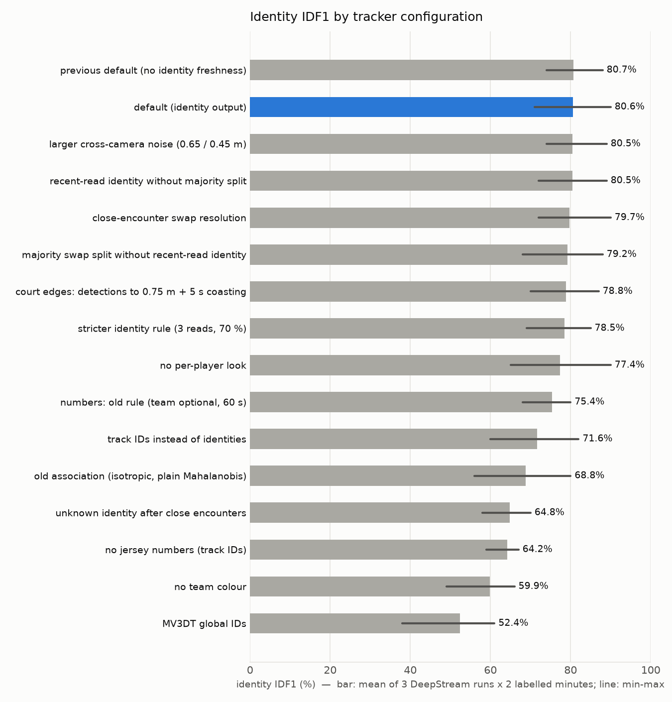

# Multi-camera basketball player tracking: Phase 7 report

Four-camera basketball court, NVIDIA DeepStream 9.1 Multi-View 3D Tracking (MV3DT), evaluated on a Dell XPS 8960
(RTX 3060 Ti 8 GB) with deployment on a Jetson Orin Nano Super in mind. Date: 2026-10-27.

All results come from DeepStream runs on the final calibration, which places every camera on its physical mount
(section 5): three runs (`mount_r1`-`mount_r3`) for the main results, three more with the court tracker running
inside DeepStream (`ct3_r1`-`ct3_r3`, section 4.8). Every result uses the court tracker's main configuration, which
is causal as deployed: every input is available live and needs no operator (section 3). All court-tracker figures were
regenerated with the final code (`scripts/phase8_reevaluate.sh`).

## 1. Summary

**Recommendation.** Use DeepStream for detection, per-camera tracking and jersey reading. Then run the *court tracker*
developed here on its output and report each player by identity (team + jersey number), not by track ID.

| What is reported | Identity IDF1 (3 DeepStream runs x 2 labelled minutes) |
|---|---|
| MV3DT global IDs as delivered | 52.4 % (38-61 %) |
| Court tracker, track IDs | 71.6 % (60-82 %) |
| **Court tracker, player identities, every input causal (recommended)** | **80.6 % (71-90 %)** |
| The same, running inside DeepStream in C++ (3 further runs, section 4.8) | 80.0 % (71-87 %) |
| For comparison: with inputs prepared offline from the whole recording (section 4.6) | 79.2 % (74-89 %) |

IDF1 here is the share of labelled detections that end up on the output unit matched to the right player. It's
measured on hand-labelled ground truth (section 2.3).

- **Speed on the 3060 Ti:** the DeepStream pipeline with jersey reading runs at about 56 fps per camera (real time
  is 30). The court tracker takes about 1.9 ms per frame on one CPU core in Python, and about 0.1 ms in its C++ port,
  which gives identical output (section 4.7).
- **Running live inside DeepStream (section 4.8):** the C++ court tracker and the automatic team model run as part of
  the pipeline and send one Kafka message per frame with every player's identity and court position. The pipeline
  still runs at about 58 fps per camera. The live output is reproduced exactly by both the C++ and the Python versions
  replaying its recorded inputs, and scores the same as the Python version on the same runs.
- **Seated spectators are dropped (section 4.9).** Front-row spectators used to reach the output and take players'
  identities. A geometric rule now removes them (from 61 % of their detections in the output to 4 %, with no
  identities), at no cost to the player score.
- **Still not good enough for reliable per-player statistics.** About 20 % of player time is credited to the wrong
  player or no player. Most of that is a *wrong* identity (about 15 %), not a missing one (about 4.5 %; section 4.4).
- **Every input is causal, with no operator.** The camera position correction is measured once at installation
  (on separate runs) and stored with the calibration. The two teams are found automatically from torso colour as the
  game runs (two teams and everyone else, named A and B). Inputs prepared offline from the whole recording, with
  hand-named team colours, score no better (79.2 %, section 4.6).
- **The automatic team model failed once (section 4.6).** In one of six runs, the two teams' names got mixed up during
  the last minute of the game (6:10-7:00), after the labelled minutes. The scores don't show it; the cause is not yet
  fixed (section 9).
- **Results vary from run to run.** Repeated DeepStream runs of the same configuration give different MV3DT IDs and
  jersey reads. Per-minute identity IDF1 ranges from 71 % to 90 %, so every number here is an average over three
  runs.
- **Measured deployment options (section 6):**
  - **INT8 detector:** 55 % faster than FP16 on the 3060 Ti, at 6-7 points lower end-to-end identity accuracy
    (4-5 points with a lower detection threshold).
  - **Detector every 2nd or 3rd frame:** costs 14-28 points with MV3DT and barely speeds anything up, so it's ruled
    out.
  - **Jetson (estimated from these measurements):** four cameras at 30 fps look borderline to feasible on an AGX
    Orin with INT8, and not feasible on an Orin Nano Super.
- **Camera placement matters more than the number of cameras.** Moving the same four cameras from the backboards to
  high corner mounts would raise the share of the court seen by two cameras at jersey-readable size, from clearly
  different directions, from 20 % to about 80 % (simulated). Six high wall cameras would reach about 96 %, but
  probably need more compute than the Orin Nano Super offers (section 7).

## 2. Setup

### 2.1 Hardware and software
- Ubuntu 24.04, RTX 3060 Ti 8 GB, driver 580, Docker with the NVIDIA Container Toolkit.
- DeepStream 9.1: container `nvcr.io/nvidia/deepstream:9.1-triton-multiarch`, repo `NVIDIA/DeepStream` tag
  `v9.1.0.2`, app `deepstream-test5-app` with a small patch (court filter, torso objects, jersey log, court tracker).
- Brokers: mosquitto (MQTT, inter-camera tracker messages) and Kafka 4.2.0 (MV3DT metadata).

### 2.2 Cameras and video
- **Mounting:** two camera pairs, each on one apparatus on top of a backboard, 6-10 in apart. NL + FR sit at the left
  end, NR + FL at the right end. The N cameras look steeply down at the near half; the F cameras look across at the
  far half.
- **Video:** the cameras record 4K; this pipeline uses a 1920 × 1080, 30 fps, undistorted transcode of about 15
  minutes. **0:00-7:00 is a game** (red vs maroon, 2 referees); after that comes a warm-up, which is out of scope.
- **Calibration:** one 3 × 4 projection matrix per camera, in metres with the origin at centre court, fitted with the
  cameras on their mounts (section 5).

### 2.3 Ground truth
Two labelled minutes of the game: 2:00-3:00 and 4:00-5:00. Each has 30 moments, 2 s apart. Every person on court was
labelled at each moment, giving about 380 labelled groups per minute. About 325 and 343 detections per minute carry
a full identity, across about 10 people per minute (players from both teams, including substitutes).

- **Labelling:** done by the user on a web page, with the tracker's guess shown but not counted.
- **Scoring:** labels attach to detection keys (frame, camera, box), so any tracker that uses the same detections can
  be scored. They carry over to new DeepStream runs by box overlap.
- **Refs:** both referees were labelled only as "ref", so referees aren't scored.
- **Limit:** both minutes have been used for development decisions, so there is no untouched held-out data left
  (section 8).

## 3. Pipeline

1. **Detection:** PeopleNet 2.6.3 (FP16, 960 × 544, every frame, batch of 4 cameras). PeopleNet Transformer and
   RT-DETR were also tried; they ran far slower (about 10 and 21 fps per camera) with no tracking advantage.
2. **Court filter** (custom probe): drops detections whose floor point lies outside the court plus 0.75 m (benches,
   crowd, scorer's table).
3. **MV3DT** (NvDCF tracker with the single-view 3D person model, multi-view association over MQTT). Provides
   per-camera tracklets and 3D foot positions.
4. **Jersey reading** inside DeepStream:
   - torso objects are taken from player boxes at least 150 px tall
   - a text detector (PP-OCRv4 det, 384 × 480) finds text boxes
   - a digit recogniser (PP-OCRv4 rec, 48 × 64) reads 1-2 digit numbers

   About 14.5 reads per second over the game; 94.5-94.9 % of reads checked against the ground truth are correct.
5. **Court tracker** (`tools/world_tracker.py`, Python, causal, runs on the Kafka output). A court-plane Kalman tracker:
   - **matching:** direction-aware measurement noise and a likelihood cost
   - **identity cues:** team colour (torso histograms, automatic online team model) and jersey numbers, where
     identity = team + number
   - **identity output:** an online roster and a per-player appearance model
   - **identity freshness:** identities come from recent reads (10 s), and a track splits when a majority of its
     recent reads show another number

   - **seated spectators:** detections whose box bottom and MV3DT foot point disagree in the way seated people do
     are dropped before tracking (section 4.9)

   The same tracker runs inside DeepStream as a C++ probe (`apps/courttrack`, section 4.8).

   Everything is causal; the output is final as soon as it's made. Its inputs are all available live, with no
   operator:
   - **camera position bias:** a constant offset per camera (mainly NL −0.20 m and NR +0.18 m along the court),
     measured once at installation from detections of the same person in two cameras and stored with the calibration
     (here measured on the runs `ct2_r1`-`ct2_r3`, which are not used for any result)
   - **team colours:** an online model that clusters the tracks' torso colours as the game runs and names the two
     clusters with the most jersey reads as the teams (section 4.6)
   - **no spectator filter** after the run; seated spectators are dropped by a causal rule (section 4.9)

   Section 4.6 compares these with versions prepared offline from the whole recording, which an earlier version of
   this report used for its main results.

## 4. Results

### 4.1 Speed (RTX 3060 Ti)

| Run | fps per camera | GPU use (median) | GPU memory peak |
|---|---|---|---|
| mount_r1 | 56.0 | 87 % | 2.75 GB |
| mount_r2 | 56.6 | 89 % | 2.68 GB |
| mount_r3 | 57.4 | 89 % | 2.60 GB |

These figures include the on-screen display, the tiler and writing an annotated video, none of which a deployment
needs. Without them the same pipeline runs at 61 fps per camera; with an INT8 detector, at 95 fps (section 6.1).
- **Jersey reader, per crop:** text detector 0.36 ms, recogniser 0.16 ms (TensorRT FP16).
- **Court tracker:** 1.9 ms per frame mean, 4.7 ms p99, on one core of an i7-13700 (Python). The C++ port runs at
  0.08-0.11 ms per frame on the same inputs (section 4.7).

### 4.2 Accuracy by configuration



Paired against the default, by run and minute:

| Change from the default | Identity IDF1 | Paired difference | Pairs where the default wins |
|---|---|---|---|
| (default) | 80.6 % | — | — |
| no team colour | 59.9 % | −20.7 | 6 of 6 |
| no jersey numbers | 64.2 % | −16.4 | 6 of 6 |
| old association (isotropic noise, plain Mahalanobis) | 68.8 % | −11.8 | 6 of 6 (and +17 switches) |
| track IDs instead of identities | 71.6 % | −9.0 | 5 of 6 |
| numbers rule: team optional, 60 s relink | 75.4 % | −5.2 | 4 of 4 (2 ties; and +8 switches) |
| no per-player look | 77.4 % | −3.2 | 5 of 5 (1 tie) |
| no identity freshness | 80.7 % | +0.1 | 3 of 6 |
| MV3DT global IDs | 52.4 % | −28.2 | 6 of 6 |

Pairs whose difference was under half a point count as ties.

- **Biggest contributors:** team colour, jersey numbers and the direction-aware association (which also keeps
  duplicate tracks to about 2-5 % of player time, section 4.5); the default wins every pair.
- **Reporting identities instead of track IDs:** 9 points, winning 5 of 6 pairs.
- **Smaller contributors (3-5 points):** the team-required numbers rule and the per-player look, which win every pair
  that isn't a tie.
- **Identity freshness** (identities from recent reads, majority split) makes no difference on average in this
  configuration (3 pairs better and 3 worse without it), so its benefit is not established. It stays in for now.

### 4.3 Run-to-run variation
- **Detections are almost the same:** two DeepStream runs of the same configuration share 98.7 % of their boxes.
- **Everything built on them differs:** the MV3DT IDs, per-camera tracklets and the jersey reads attached to them come
  out differently, most likely because the order in which cameras exchange tracker messages varies.
- **Effect on scores:** per-minute identity IDF1 of the default ranges from 71 % to 90 % across the three runs. All
  comparisons here are therefore paired by run and minute and averaged over three runs. Differences under about
  2 points aren't reliable.

### 4.4 Where accuracy is still lost


- **Wrong number carried over from another player (9.4 %):** a track swaps players and keeps the old identity until
  enough new reads arrive. Reads are sparse: a given player is read only every several seconds.
- **Wrong number, other (4.8 %):** misreads, and identities established from too few reads.
- **Unidentified (3.9 %):** almost all of it (3.5 %) on tracks with readable crops and reads that never reached an
  identity.
- **Wrong team with the right number (0.9 %):** on the numbers both teams wear (1 and 3).
- **Missed by the tracker (0.6 %):** small; part of it is the seated-spectator rule (section 4.9). Detection and court
  filtering aren't the bottleneck.

### 4.5 Where on the court


Over the whole game (mount_r1, default tracker):

| Zone | New identities per player-minute | Tracks lost per player-minute | Time with a duplicate track |
|---|---|---|---|
| Interior | 1.4 | 1.8 | 3.5 % |
| Within 1.5 m of a sideline | 3.6 | 6.9 | 0.6 % |
| Within 1.5 m of a baseline | 6.2 | 7.9 | 0.4 % |
| Left-end third | 2.1 | 2.9 | 4.9 % |
| Right-end third | 1.8 | 2.3 | 1.5 % |

- **Lines:** tracks are lost about four times as often near the lines as in the interior. Players leave the court
  there, and often only one camera sees them.
- **Ends:** the left end is somewhat worse than the right end.

### 4.6 Causal inputs and their offline counterparts

The main configuration uses only inputs a live system has (section 3). Each was replaced with an alternative,
including the versions prepared offline from the whole recording that an earlier version of this report used (an
upper reference a live system can't have), and re-scored (Python court tracker, 3 runs x 2 labelled minutes, paired
against the main configuration; `tools/causal_eval.py`, `reports/causal_inputs.md`).

| Input of the main configuration | Replaced with | Identity IDF1 | Paired difference | Pairs better / worse |
|---|---|---|---|---|
| **All causal** (main configuration) | — | **80.6 %** (71-90 %) ¹ | — | — |
| Camera bias, fixed at installation | estimated over the whole run (offline) | 79.8 % | −0.8 | 0 / 4 |
| | estimated live from the first 2 minutes | 80.5 % | −0.1 | 2 / 2 |
| | none | 78.3 % | −2.3 | 0 / 6 |
| Online team model, 3 clusters (two teams, everyone else) | online model, 4 clusters (two teams, referees, other) | 72.6 % | −8.0 | 0 / 6 |
| | offline model: clustered over the game, clusters named by hand | 81.0 % | +0.4 | 2 / 2 |
| | offline model from the first 2 minutes only ² | 79.3 % | −1.3 | 0 / 2 |
| No spectator filter | offline spectator filter and post-stitching (whole tracks) | 80.5 % | −0.1 | 0 / 1 |
| **All three offline** | whole-run bias, hand-named team model, spectator filter | 79.2 % (74-89 %) | −1.4 | 2 / 3 |

¹ Seed 0 of the online model's first clustering (all rows); seeds 0-4 all give 80.6 %.
² Clusters named after the nearest hand-named cluster, standing in for an operator.

- **Camera bias:** very stable across runs (NL −0.18 to −0.21 m, NR +0.17 to +0.20 m), so a value measured at
  installation and stored with the calibration works (`tools/calib_bias.py` writes it into each camera's file as
  `courtTrackerBias_m`). It was measured on three runs not used here (`ct2_r1`-`ct2_r3`) and must be re-measured
  whenever the calibration changes. Without any correction the score drops 2.3 points (all 6 pairs worse).
- **Automatic team colours** (`tools/online_teams.py`), with no operator:
  - each court track keeps a colour summary of its torso crops; every 5 s, the summaries of the last 3 minutes
    are clustered into three groups
  - the two clusters whose tracks get the most jersey reads per detection are the teams (players' numbers are read,
    referees' and spectators' hardly ever); everything else, referees included, gets no team label
  - team names A/B follow their cluster from one clustering to the next, so identities (A:23) stay stable
  - per-camera colour correction is learned as the game runs; the first model forms after 30 s, and before it no
    detection has a team label
  - each re-clustering starts from the previous centres, which keeps the result independent of the random start of
    the first model here (all five seeds give the same score)
- **The offline versions don't do better:** the hand-named team model scores +0.4 points (2 pairs each way) and all
  offline inputs together −1.4, both within the run-to-run noise. Four clusters (a separate referee cluster) do much
  worse, −8.0 points; the reason hasn't been investigated.
- **Checked crop by crop** against the hand-named model, over the whole game (`tools/team_label_check.py`,
  `reports/team_label_check.txt`; the three mount runs with the main configuration, and the Python reference on the
  three `ct3` runs):
  - **First two minutes:** maroon was always A and red B, but between 0:30 (first model) and 1:00, 12-23 % of red
    crops were labelled A, and between 1:00 and 2:00 up to 29 crops per run.
  - **2:00 to the end of the game:** in five of the six runs, no crop got the other team's name and at most 7 referee
    crops per run a team label.
  - **One failure:** in mount_r2, a re-clustering at 6:10 reorganised the clusters: the jersey-read rate of the
    "everyone else" cluster had risen to that of the teams, and most maroon crops moved into a cluster with red's name
    or no name. From 6:00 to 7:00, 1,153 of 1,314 maroon crops got red's name and 706 of 759 referee crops a team
    label. It falls after the labelled minutes, so the scores don't show it. With the bias measured on another mount
    run (the previous version of this report) the same run didn't fail, so the model is sensitive to small input
    changes here. Not yet fixed (section 9).
  - **Unchecked:** the online model also gives team names to about 6,600-7,700 crops per run that the hand-named
    model left unlabelled, mostly A. It hasn't been checked whether those are players or people beside the court.
- **Caution:**
  - **Selection bias:** the online model's settings (3 clusters, the read-rate rule) were chosen on these same runs
    and minutes, and the differences to the offline versions are within the run-to-run noise. So the fair reading is
    "as good as the offline version", not better.
  - **One game:** it's tested on one game only.
  - **The read-rate rule** assumes players' numbers are read clearly more often than anyone else's shirt. Here
    the team clusters got reads on 2.5-4.6 % of detections from 2:00 to the end of the game (mount runs), the rest on
    at most 1.6 % in mount_r1 and mount_r3. In mount_r2 the rest reached 2.7 %, which is where the failure happened.

### 4.7 C++ port of the court tracker

`apps/courttrack` is a C++ port of the court tracker's default configuration (`courttrack.cpp`) and of the online team
model (`online_teams.cpp`), for use inside the DeepStream pipeline. Both were checked by feeding them the exact
per-frame inputs of the Python version (recorded with `tools/courttrack_export.py`, replayed with
`apps/courttrack/ct_replay`):

- **Same output:** on mount_r1-r3, all of about 516,000 detection identities per run are identical to the Python
  version's in the main configuration (and, before this version, with the offline inputs), as are identity IDF1 and
  switch counts on both labelled minutes.
- **Speed:** 0.08-0.11 ms per frame on one core of the i7, against 1.9 ms for the Python version. The team model's
  re-clustering every 5 s takes up to about 6 ms.

### 4.8 Running inside DeepStream

The court tracker now runs live in the pipeline (`scripts/run_mv3dt.sh` with `COURTTRACK=1`; probe
`apps/courttrack/courttrack_probe.cpp`, after the jersey reader):

- **Inputs:** MV3DT's world foot points, the court filter (0.3 m margin), the fixed bias from the camera files, the
  jersey reads of the same frame, and torso colour histograms. Every 3rd frame, the torso of each good crop
  (FL, FR, NR) is cut out of the frame with NVIDIA's `NvBufSurfTransform` into a 32 × 48 tile and its hue x saturation
  histogram computed on the CPU. This works the same way on a Jetson.
- **Processing:** once all four cameras of a frame have arrived, the online team model labels the crops, the court
  tracker steps, and the team model learns from the tracker's assignment.
- **Output:** one JSON message per frame on its own Kafka topic (`courttrack`) with, per player: court track id,
  identity (e.g. `A:23`) and team, position and velocity on the court, whether it was seen this frame or predicted,
  how many cameras saw it, and the detections it came from (camera + MV3DT object id). The per-camera messages are
  unchanged. Consumers should key on the track id: a track's identity can change (when first established, or after
  a swap is detected), and a briefly unseen player is kept with a predicted position for up to 2 s.
- **Logs for evaluation:** the identity of every detection (CSV) and the tracker's inputs, which `ct_replay` and the
  Python reference can replay.

**Checked on three new full-game runs** (`ct3_r1`-`ct3_r3`, FP16, no display, with the seated-spectator rule):

| | Result |
|---|---|
| C++ replay of the recorded inputs | identical to the live output (all of about 515,000 detection identities per run) |
| Python reference replaying the same inputs | identical to the live output |
| Identity IDF1, live | **80.0 %** (71-87 %); end-to-end 79.1 % (98.8 % of labelled people detected) |
| Python reference on the same runs (Kafka output, OpenCV histograms) | 79.1 % |
| Pipeline speed with the court tracker | 57.5-58.2 fps per camera, with the evaluation logs written to this PC's hard disk (58.6-60.2 in three earlier runs; 61.0 without the court tracker, one run) |
| Court tracker + team model, in the pipeline | 1.1 ms mean, about 11 ms p99, 55-63 ms max per frame |
| Torso histograms, in the pipeline | 2.7 ms mean per four-camera batch (every 3rd frame) |

- **Live vs Python reference:** the same score (80.0 % against 79.1 %; 2 run-minutes better, 4 within half a point).
  The live pipeline computes the torso histograms differently (NV12 frames scaled to small tiles, against OpenCV on
  full-resolution frames). In three earlier live runs, replaying the live inputs with the OpenCV histograms swapped in
  changed the score by 0.5 points with no consistent direction: the two kinds of histogram differ noticeably, but the
  team model learns from whichever it gets.
- **Exact reproduction needed three fixes, which apply to the Python reference too:**
  - **Duplicate ids:** MV3DT occasionally gives two different people the same object id in one camera and frame
    (70-200 times per game, several metres apart). Everything downstream is keyed by (frame, camera, id), so now only
    the first is kept. Because tracking decisions amplify small input changes, this alone moved the then main
    configuration (offline inputs) from 78.3 % to 77.8 %; all court-tracker figures in this report were regenerated
    with it.
  - **Track identity:** the roster counted tracks by memory address, which a new track can reuse after a merge;
    tracks now carry a permanent serial number.
  - **Arithmetic:** the colour statistics are summed in a fixed order (not NumPy's pairwise or BLAS summation),
    fused multiply-add is disabled in the C++ builds (`-ffp-contract=off`, which matters on the Jetson's ARM CPU),
    and NumPy's percentile formula is matched exactly.
- **Speed in the pipeline:** the same computation takes about 0.1 ms per frame when replayed alone, against 1.3 ms in
  the pipeline, presumably because it shares the CPU with DeepStream's threads (not investigated). The slowest frames
  are the team model's re-clustering, which runs on the probe's streaming thread. On a Jetson, this is the part to
  watch: it can be moved to a worker thread with its result applied a fixed number of frames later, which keeps the
  output reproducible.
- **Logging:** writing the evaluation logs to this PC's hard disk stalls for up to 3.6 s at times. The logs are for
  evaluation only and would be off in deployment. The Kafka send is timed together with them (2.4-2.6 ms per frame
  on average, including the stalls).

### 4.9 Seated spectators

The labels include 160 crops of people who aren't players (about 450 detections per set of three runs). Almost all
of them are spectators in the front-row seats, seen by FR (414 of the 453 in the mount runs), which looks across the
court at them (`tools/nonplayer_eval.py`, `reports/nonplayer_output*.md`).

- **Why they got through:** their boxes end at the line, so the court filter keeps them. MV3DT's body model assumes a
  standing person, so it places their feet about 2 m inside the court (median), among the players.
- **What it cost:** they took real players' identities (A:1, B:0, A:3, ...), so the output carried the same identity
  twice, and players passing by got merged into their tracks. The identity score didn't show it, because it is scored
  on players only; the offline spectator filter of section 4.6 didn't catch them either, since these tracks aren't static.
- **The rule:** for a seated person, the box bottom projected onto the floor lands at their seat, at or just outside
  the line, while MV3DT puts the feet 2 m further in. For players the two agree to about 0.3 m. A detection is now
  dropped before tracking when its two foot points are more than 1 m apart *and* its box-bottom point is less than
  0.6 m inside the lines (boxes cut by the bottom image edge are never dropped). On the labelled detections this
  catches 96 % of the spectators and 0.5 % of the players. Body height alone separates them poorly (23 % of
  spectators under 1.4 m, against 3 % of players). No pose model is needed; both points are already available, in
  Python and in the DeepStream probe.

| Labelled detections | Spectators in the output | Spectators with an identity | Players in the output | Identity IDF1 (players) |
|---|---|---|---|---|
| Python reference, main configuration, without the rule (mount runs) | 61 % | 21 % | 100 % | 79.8 % |
| **Python reference, main configuration, with the rule** (mount runs) | **4 %** | **0 %** | 99 % | 80.6 % |
| Live in DeepStream, without the rule (`ct2` runs) | 61 % | 24 % | 100 % | 75.6 % |
| **Live in DeepStream, with the rule** (`ct3` runs) | **4 %** | **0.2 %** (1 detection) | 99 % | 80.0 % |

The score gains are within the run-to-run noise; what matters is that the false identities are gone at no cost to the
players. The rule's thresholds were set on this venue's front row and should be checked at other venues.

## 5. Calibration

The final calibration places each camera where it physically is: the pairs on their backboard apparatus.

- **Line tracing:** each camera's court lines were re-traced automatically from a player-free median image
  (`tools/court_refine.py`). This replaced hand-traced lines; on FL those had followed the "LET'S HOOP" lettering and
  the logo instead of the paint, and its overlay was visibly rotated (spotted by the user).
- **Joint fit on the mounts** (`tools/calib_mount.py`): all four cameras are fitted together, with each far camera
  held within 0.25 m per axis of its partner (FL with NR, FR with NL) and the standard HS/NCAA markings. The court's
  length and width are fitted.

| Camera | Court-line fit error | Position (x, y, z), m | Distance to partner |
|---|---|---|---|
| NL | 1.75 px | (−9.41, 0.05, 3.81) | — |
| FR | 1.88 px | (−9.66, 0.02, 4.06) | 0.35 m to NL |
| NR | 2.28 px | (9.57, 0.02, 4.05) | — |
| FL | 3.02 px | (9.82, 0.19, 4.16) | 0.33 m to NR |

- **The constraint costs little:** fitted without the mount constraint, the errors are 1.68, 1.80, 2.05 and 2.41 px.
  FL's larger error comes mostly from its far sideline, which runs along the edge of its image.
- **Court size:** fitted at 70.3 × 45.1 ft. All tools read it from `tools/court.py`.
- **Single source of truth:** the camera files are in `datasets/gym/camInfo`. Earlier versions are archived
  beside them, and each run keeps the copy it used in `camInfo_used/`.
- **Independent check:** the 3-point arc (19.75 ft) wasn't used in the fit, yet it lands on the painted arc (FL shown
  below).


**Position consistency between cameras.** For the same labelled person at the same moment, MV3DT foot points from two
cameras differ by a median 0.37 m (18 % of pairs over 0.9 m; 1,114 pairs over three runs). The error runs mostly
along each camera's line of sight. It comes from estimating feet out of boxes (posture, boxes cut by the frame edge),
not from the calibration.

## 6. Deployment options: measured on the 3060 Ti, estimated for Jetson

### 6.1 Measured: INT8, detector interval and no display

Before any of these is proposed for a Jetson, each was run on the 3060 Ti (three full DeepStream runs per variant
unless noted, all without on-screen display or annotated video) and scored on the ground truth. **End-to-end**
counts correctly identified labelled detections over *all* labelled detections, so people a variant fails to detect
count as errors.

| Variant | fps per camera | GPU use | Labelled people detected | End-to-end identity |
|---|---|---|---|---|
| FP16, detector every frame, with display (mount_r1-r3) | 56.7 | 88 % | 98.8 % | 79.7 % (70-89 %) |
| FP16, detector every frame (1 run) | 61.0 | 87 % | 99.0 % | 78.5 % (71-86 %) |
| **INT8, detector every frame** | **94.6** | 88 % | 94.7 % | **72.3 %** (63-83 %) |
| INT8, detector every frame, detection threshold 0.1 instead of 0.2 | 93.2 ¹ | 90 % | 97.9 % | 74.9 % (63-83 %) |
| FP16, detector every 2nd frame | 75.1 | 76 % | 82.9 % | 65.2 % (60-69 %) |
| FP16, detector every 3rd frame | 45.7 | 68 % | 66.6 % | 51.6 % (40-63 %) |
| INT8, detector every 2nd frame | 92.4 | 76 % | 75.4 % | 59.7 % (57-61 %) |

¹ Mean of two runs. The third ran at 65 fps while other CPU-heavy jobs ran on the same PC, so its speed is
not comparable; its accuracy is included.

Full tables: `reports/deploy_end_to_end.md`, `reports/deploy_variants_detection.md`, `reports/deploy_idf1_*.md`.

- **No display:** about 8 % faster (61 vs 57 fps per camera) with identical output. Assumed for every embedded
  configuration below.
- **INT8 detector:**
  - **Speed:** 55 % faster than FP16 (95 vs 61 fps per camera).
  - **Accuracy:** 6-7 points lower end-to-end (72.3 % vs 78.5-79.7 %). INT8 detects about 4 % fewer labelled
    people (players 93.4 % vs 98.7 %, non-players 70.8 % vs 94.4 %; `reports/deploy_int8_by_category.md`).
  - **Lower detection threshold:** lowering it from 0.2 to 0.1 recovers most of the missed people (97.9 % detected,
    players 96.9 %), and part of the accuracy: end-to-end 74.9 % against 72.3 %, with identity IDF1 on detected
    labels about the same (76.5 % vs 76.3 %). So missed detections explain part of INT8's loss, not all of it.
    INT8 boxes also sit differently: only 88-89 % of them match an FP16 box (IoU ≥ 0.5), against 98.6 % between two
    FP16 runs. That suggests box placement, which feeds the floor positions, as a further cause. Not adopted yet; both
    are being investigated (GitHub issue #1).
  - **Calibration:** NVIDIA's published calibration file was made with an older TensorRT (10.3), which names the
    activation layers differently. With it, most layers fell back to full precision and the detector was slower than
    FP16. The runs above use a calibration made with the deployment TensorRT version (10.16) on 400 frames from the
    video (`tools/int8_calibrate.py`). A Jetson needs a calibration made with its own TensorRT version.
- **Detector every 2nd or 3rd frame (DeepStream `interval`): not usable with MV3DT.**
  - **Accuracy:** it costs 14-28 points end-to-end against the three FP16 runs.
  - **Speed:** it barely helps (every 3rd frame is even slower than every frame). GPU use falls while speed doesn't
    rise, so the bottleneck moves to MV3DT's own tracking work.
  - **Output rate:** with MV3DT's visual tracker off, positions come out only on detector frames.
  - **Tracker changes needed:** MV3DT drops a new track the first time it misses a detection, so the runs needed a
    longer early-termination window (3 frames for every 2nd frame, 4 for every 3rd), and the court tracker's
    frame-counting rules had to be scaled to the detection rate.

  NVIDIA's MV3DT configurations always detect on every frame.

### 6.2 Estimated for Orin Nano Super and AGX Orin

These are **estimates**: the 3060 Ti measurements scaled by hardware ratios. Nothing has been run on a Jetson.
Device specifications are NVIDIA's published figures as known at the time of writing; check them against current
spec sheets before buying.

| | AGX Orin 64 GB | AGX Orin 32 GB | Orin Nano Super 8 GB |
|---|---|---|---|
| GPU | 2048 CUDA cores, 64 tensor cores | 1792 CUDA cores, 56 tensor cores | 1024 CUDA cores, 32 tensor cores |
| Deep-learning accelerators (DLA) | 2 | 2 | none |
| AI performance (INT8, sparse, as quoted) | up to 275 TOPS | up to 200 TOPS | up to 67 TOPS |
| CPU | 12-core Cortex-A78AE | 8-core Cortex-A78AE | 6-core Cortex-A78AE |
| Memory / bandwidth | 64 GB, 205 GB/s | 32 GB, 205 GB/s | 8 GB, 102 GB/s |
| Hardware video encoder | yes | yes | no |
| Hardware decode, H.265 (approximate) | about 7 × 4K30 or 22 × 1080p30 | similar | about 2 × 4K30 or 11 × 1080p30 |
| Power | 15-60 W | 15-40 W | 7-25 W |
| Price (developer kit / module, approximate) | about US$2,000 kit | about US$1,000 module | about US$250 kit |

**Assumed relative speed on this workload:** the Orin Nano Super 5-8 times slower than the 3060 Ti, the AGX Orin
64 GB 2.5-3.5 times slower (twice the Nano's GPU cores and memory bandwidth), the AGX Orin 32 GB slightly slower
still.

| Configuration (detector every frame, no display) | 3060 Ti (measured) | AGX Orin 64 GB (estimate) | Orin Nano Super (estimate) |
|---|---|---|---|
| FP16: fps per camera with 4 cameras | 61 | 17-24 | 8-12 |
| INT8: fps per camera with 4 cameras | 95 | **27-38** | **12-19** |
| INT8: fps per camera with 6 cameras | 63 | 18-25 | 8-13 |
| INT8: GPU share of one 30 fps camera | 7 % | 17-25 % | 35-56 % |

**What this means:**
- **Orin Nano Super:** four cameras at 30 fps don't look feasible, even with INT8. Detecting every 2nd frame was
  ruled out in 6.1. What remains:
  - two cameras
  - or a lower camera frame rate. Running the cameras at 15 fps, with every frame detected, is a different thing
    from a detector interval and **is untested**.
- **AGX Orin 64 GB:** four cameras at 30 fps with INT8 look borderline to feasible.
  - **Six cameras at 30 fps** don't look feasible on the GPU alone.
  - **Its two DLAs** could take the INT8 detector off the GPU (DeepStream supports this), but their throughput for
    this model must be measured.
  - **4K decoding:** four 4K streams for the hybrid jersey reading (section 7.3) are within its decoder, not the
    Orin Nano Super's.
- **Court tracker:** inside the pipeline on the 3060 Ti PC it takes 1.1 ms per frame on average, with p99 about 11 ms
  and occasional frames up to 63 ms (the team model's re-clustering; section 4.8). The Orin's cores are slower, so
  the worst frames could exceed a 33 ms frame period. That doesn't drop frames by itself, but it needs measuring on
  the device; moving the re-clustering to a worker thread is the fix if needed. Finished tracks also need pruning to
  the relink window (memory and time grow over a game).
- **Brokers:** MV3DT exchanges messages over MQTT between its per-camera trackers; on a single device the broker runs
  locally. Kafka is only needed if metadata leaves the device.

**Recommendation.**
- **For four cameras at 30 fps (current or corner layout), choose the AGX Orin.** The 32 GB version may be enough;
  the 64 GB version adds CPU cores and memory rather than much GPU.
- **The Orin Nano Super would need fewer cameras or a lower frame rate,** and a 15 fps test should come first.
- **Before buying, measure on the device:**
  - fps per camera (INT8, no display)
  - DLA throughput (AGX Orin)
  - decode capacity
  - accuracy, re-scored with `tools/multi_eval.py` after re-calibrating INT8 for the device's TensorRT

## 7. Camera placement and quantity

The current cameras sit at backboard height and see players mostly from the side. That is the main reason tracks
swap in close encounters (section 4.4). This section compares candidate layouts with a camera-layout simulator
(`tools/camera_layout.py`) and sets them against compute.

### 7.1 Method
- **Model:** each camera is a 1920 × 1080 pinhole at a given position, aim point and lens field of view, over the
  fitted court. For each 0.5 m floor cell and a standing 1.8 m player, it computes:
  - which cameras see the whole player
  - the player's height in pixels: at least **150 px is readable** for the jersey reader, at least 80 px detectable
  - how steeply each camera looks down, and the floor length hidden behind a player ("shadow"; shorter means fewer
    occlusions)
  - the largest angle between two readable cameras' viewing directions. At least **45°** apart is needed to
    triangulate positions and separate players who overlap in one view.
- **Validation:** for the current cameras, real detection boxes measure 0.92-1.02 times the predicted standing height
  (median per camera, mount_r1). So the model's pixel sizes are realistic.
- **Fair comparison:** each new camera's lens (50-95° horizontal) and aim point are chosen by a search that maximises
  the area seen by two readable cameras at least 45° apart. Existing cameras stay as calibrated.
- **Venue assumptions, to be replaced by measurements:** walls 2 m beyond the lines, wall mounts up to 6 m high. Room
  dimensions and ceiling height weren't available.

### 7.2 Results


| Layout (mounts 6 m high) | Streams | ≥2 readable views, ≥45° apart | ≥3 readable views | No readable view | Median look-down / shadow |
|---|---|---|---|---|---|
| A. Current: 4 on the backboards | 4 | 20 % | 0 % | 6 % | 15° / 9.2 m |
| E. Keep the 2 far backboard cameras, move 2 to the sideline walls at half court | 4 | 65 % | 35 % | 0 % | 20° / 6.1 m |
| **C. 4 high in the corners** (lenses about 60°, aimed across the court) | **4** | **78 %** | 53 % | 9 % | 26° / 4.4 m |
| B. Current 4 + 2 on the sideline walls at half court | 6 | 70 % | 53 % | 0 % | 30° / 4.0 m |
| D. 4 corners + 2 on the sideline walls at half court | 6 | 93 % | 69 % | 1 % | 27° / 4.3 m |
| **F. 4 on the sideline walls at the quarter lines + 1 per baseline wall** (lenses 50-70°) | **6** | **96 %** | 64 % | 0 % | 28° / 4.1 m |

The table and figure are regenerated by `python -m tools.camera_layout` into `reports/camera_layouts.md` and
`reports/figures/camera_layouts.png`.

**Mounting height** (`reports/camera_layouts_height.md`):

| Height | C: ≥2 readable views ≥45° apart | C: no readable view | C: shadow | F: ≥2 readable views ≥45° apart | F: shadow |
|---|---|---|---|---|---|
| 4.5 m | 85 % | 2 % | 7.5 m | 98 % | 6.3 m |
| 5 m | 84 % | 2 % | 6.4 m | 97 % | 5.2 m |
| 6 m | 78 % | 9 % | 4.4 m | 96 % | 4.1 m |
| 7 m | 80 % | 3 % | 4.2 m | 92 % | 3.1 m |

- **Lower mounts:** players appear larger, so slightly more of the court is readable.
- **Higher mounts:** steeper views, which shrink the area hidden behind each player.
- **For the corner layout, about 5 m is the best balance:** 84 % two-camera coverage with only 2 % of the court
  unreadable.
- **The six-camera layout** works well anywhere from 4.5 to 6 m.

### 7.3 Compute per camera stream

| Platform (INT8 detector every frame, no display) | GPU per 30 fps stream | 4 streams | 6 streams |
|---|---|---|---|
| RTX 3060 Ti | about 7 % (measured) | about 28 % | about 42 % |
| AGX Orin 64 GB | about 17-25 % (estimate) | about 70-100 % | about 105-150 % (not feasible on the GPU alone) |
| Orin Nano Super | about 35-56 % (estimate) | about 140-220 % (not feasible) | not feasible |

- **Basis:** the measured INT8 runs (95 fps per camera at 88 % GPU use, section 6.1). The estimates assume the AGX
  Orin 64 GB is 2.5-3.5 times slower and the Orin Nano Super 5-8 times slower. Neither assumption has been measured.
- **DLAs:** on the AGX Orin, running the detector on its DLAs would free GPU time; not measured.
- **Detector interval:** not an option with MV3DT (section 6.1).
- **Jersey reading** scales with the number of readable players rather than cameras. More cameras can be held to the
  same read budget.
- **Inter-camera tracker messages** (MQTT) grow with the number of camera pairs. Six cameras is modest.
- **The cameras already record 4K;** this pipeline uses a 1080p transcode. The detector runs at 960 × 544 either way.
  So feeding the 4K streams costs mainly decoding (about 4× the decode work, to be checked on the Orin Nano Super),
  while the jersey reader would get torso crops with twice the pixels.
  - **What it wouldn't change:** with the current cameras, the simulator shows readable coverage unchanged (94 % of
    the court by at least one camera). Wherever a camera sees a player at all, the player is already at least 150 px
    tall at 1080p.
  - **What it could change:** read reliability (more reads and fewer misreads on sharp crops), which would shorten
    the wrong-identity periods after swaps (section 4.4).
  - **Lighter variant if decode is the limit:** a 1080p stream for detection and tracking plus a 4K stream at
    5-10 fps for reading only.

### 7.4 Proposal
1. **Same compute as today (4 streams): move to layout C, four corner cameras at about 5 m.**
   - Lenses about 60° horizontal, each aimed diagonally across the court.
   - Two-camera, well-separated readable coverage rises from 20 % to about 84 %.
   - Views become steeper (median 15° → 20°), and the area hidden behind players shrinks from about 9 m to about
     6 m.
   - This is the best accuracy per unit of compute. With four streams it needs an AGX Orin at 30 fps (section 6.2).
2. **If six streams are affordable, use layout F:** four sideline cameras at the quarter lines plus one per baseline,
   at 5-6 m, for about 96 % coverage. Six streams at 30 fps exceed an AGX Orin's GPU by the estimates in section 6.2,
   unless its DLAs take the detector or the cameras run at a lower frame rate (both untested).
3. **If cameras can't move:** keep the far backboard cameras and move the two near ones to the sideline walls at half
   court (layout E, still 4 streams, 65 %). Adding two cameras to the current four (layout B, 6 streams, 70 %) costs
   more compute and still does worse than four corner cameras.
4. **Whatever the layout:**
   - use identical cameras with locked exposure and focus
   - synchronise frames (hardware sync or accurate timestamps)
   - avoid pointing at windows or bright lights
   - calibrate with the mount positions as a constraint, as in section 5, ideally with measured court dimensions

**Caveat.** These are geometric coverage figures, not tracking accuracy. Before buying hardware, the best check is a
temporary installation (stands or poles at the corners) for one session, run through the same pipeline and scored
on newly labelled ground truth.

**How the professional systems compare** (general knowledge, not verified here):
- **Basketball:** NBA optical tracking (SportVU, Second Spectrum, now Hawk-Eye) uses many fixed cameras high in the
  arena rafters.
- **American football:** the NFL uses RFID chips in the shoulder pads.
- **Identity:** in all of these, operators assign identities, correct swaps live and review data after games, with
  rosters and substitutions from official feeds.
- **What this means here:** high mounts, roster and substitution input, and a light operator correction step are the
  parts worth borrowing. All of them fit this project's real-time setup.

## 8. Limitations

- **Small ground truth:** two minutes of one game on one court, with 10 players and refs not scored.
- **No clean held-out data:** both labelled minutes informed development decisions. A third labelled minute would
  give an unbiased final number.
- **Run-to-run variation:** per-minute identity IDF1 ranges from 71 % to 90 % across DeepStream runs. Three runs per
  configuration narrow it, but differences under about 2 points aren't reliable.
- **Court-specific settings:** the automatic online team model (section 4.6) is tested on this one game only, and
  mixed up the teams' names in the last minute of one of six runs. The roster is inferred online. The seated-spectator
  rule's thresholds were set on this venue. Other courts, lighting and kits are untested.
- **Sensitivity:** tracking decisions amplify tiny input changes. Removing 130-200 duplicate detections per game
  (out of about 550,000) moved the main result by half a point, and individual run-minutes by up to 3 points. A
  camera bias measured on different runs (a change of a few centimetres) was enough to make the online team model
  fail in one run. Only differences well above the run-to-run spread should be trusted.
- **Court size and venue:** the court's length and width are fitted, not measured. The camera-placement study assumes
  wall distances and mounting heights.

## 9. Next steps (prioritised)

**Done:** the court tracker runs inside DeepStream with automatic team colours, a stored camera bias, per-frame Kafka
output (section 4.8) and seated spectators dropped (section 4.9). Every reported result uses only causal inputs.

0. **Make the online team model robust** against the failure in section 4.6 (team names mixed up when the
   "everyone else" cluster gets as many jersey reads as a team), in Python and C++ together, and re-check with
   `tools/team_label_check.py` over the whole game of every run, not only the labelled minutes.
1. **Measure on the target Jetson (AGX Orin recommended for four cameras).**
   - Re-calibrate INT8 for its TensorRT version (`tools/int8_calibrate.py`).
   - Measure fps per camera without display, and DLA throughput.
   - Measure the court tracker's worst-frame time in the pipeline; move the team model's re-clustering to a worker
     thread if it exceeds the frame period.
   - Re-score accuracy with `tools/multi_eval.py` and `tools/courttrack_export.py live`.
2. **Test a lower camera frame rate (15 fps) on the 3060 Ti** if the Orin Nano Super stays in consideration. Every
   frame is detected, so MV3DT works as designed; it needs the same three-run evaluation as section 6.1.
3. **Read jerseys from the native 4K frames.** Detect and track on 1080p as now, and cut torso crops from the 4K
   frames. This needs no new hardware, only the 4K source files, and targets the largest error (wrong identities
   after swaps) through more reliable reads.
4. **Trial the corner layout (C) for one session** with temporary mounts at about 5 m, label a minute and compare with
   the current layout. Simulated two-camera coverage rises from 20 % to about 84 % at the same compute.
5. **More reads per player where it matters.** Re-read tracks for a second or two after a close encounter, and tracks
   without an identity.
6. **Label a third minute** (6:00-7:00 is still unused, up to the end of the game) for a clean held-out score before
   any final claims.
7. **Use the official roster** (numbers per team, available for real games): reject reads of numbers on neither
   roster, and settle the team of a number only one team wears. The roster can't say which colour is which team, but
   the tracker can learn that from which numbers each colour cluster is read with. This also targets the wrong-team
   errors on shared numbers.

## 10. How to reproduce

```bash
./scripts/brokers.sh start
for r in mount_r1 mount_r2 mount_r3; do
  DETECTOR_MODEL=PeopleNet2.6.3 COURT_FILTER=1 JERSEY=1 NEIGHBORS=all ./scripts/run_mv3dt.sh gym_full $r
  ~/.venvs/mv3dt/bin/python -m tools.jersey from-ds $r
  cp experiments/full_pn263_cf_jersey/{team_model.npz,teams.yml} experiments/$r/   # offline team model: comparison rows only
  ~/.venvs/mv3dt/bin/python -m tools.appearance extract $r
done
./scripts/phase7_deploy_variants.sh   # deployment variants (no display, INT8, detector interval), section 6.1
~/.venvs/mv3dt/bin/python -m tools.variant_eval --ref nodisp_r1 --runs int8_r1 int1_r1 --md reports/deploy_variants_detection.md
~/.venvs/mv3dt/bin/python -m tools.calib_bias ct2_r1 ct2_r2 ct2_r3 --write   # fixed camera bias into camInfo (runs not evaluated)
./scripts/build_court_app.sh && ./scripts/phase8_courttrack_live.sh ct3_r1 ct3_r2 ct3_r3   # section 4.8
JOBS=8 ./scripts/phase8_reevaluate.sh   # every court-tracker table and figure in this report (sections 4-6)
~/.venvs/mv3dt/bin/python -m tools.team_label_check mount_r1 mount_r2 mount_r3 ct3_r1 ct3_r2 ct3_r3 > reports/team_label_check.txt
~/.venvs/mv3dt/bin/python -m tools.camera_layout --validate mount_r1 --md reports/camera_layouts.md
python3 reports/build_page.py   # web page version
make -C apps/courttrack && ~/.venvs/mv3dt/bin/python -m tools.courttrack_export export-online mount_r1 /tmp/ct \
  && apps/courttrack/ct_replay /tmp/ct/inputs.bin /tmp/ct/cpp_out.txt \
  && ~/.venvs/mv3dt/bin/python -m tools.courttrack_export compare mount_r1 /tmp/ct   # C++ vs Python, section 4.7
```

- **Calibration:** `tools/court_refine.py <run> <cam>` (line traces), then `tools/calib_mount.py --write`.
- **Ground truth:** `gt/game_2to3`, `gt/game_4to5` (labels in `labels/`; the labelling pages are private claude.ai
  artifacts).
- **Unit tests:** `~/.venvs/mv3dt/bin/python -m pytest -q` (58 pass).

## Appendix: what was tried and did not help

Tracker options, scored on the same three runs and two minutes (`reports/multi_eval_final.md`):

| Idea | Identity IDF1 | vs default | Pairs better / worse |
|---|---|---|---|
| (default) | 80.6 % | — | — |
| Recent-read identity without the majority split | 80.5 % | −0.1 | 3 / 2 (no reliable difference) |
| Larger cross-camera noise levels (0.65 / 0.45 m) | 80.5 % | −0.1 | 4 / 2 (no reliable difference) |
| Close-encounter swap resolution from colour and reads | 79.7 % | −0.9 | 2 / 2 |
| Majority swap split without recent-read identity | 79.2 % | −1.5 | 1 / 4 |
| Keeping tracks alive at the court edges (detections to 0.75 m, 5 s coasting) | 78.8 % | −1.8 | 0 / 6 |
| Stricter identity rule (3 reads, 70 %) | 78.5 % | −2.1 | 2 / 4 |
| "Unknown" identity after close encounters | 64.8 % | −15.9 | 0 / 6 (switches double) |

**Detector every 2nd or 3rd frame** (section 6.1): 65.2 % and 51.6 % end-to-end identity accuracy against 79.7 %,
with little or no speed gain. Ruled out with MV3DT.

**Jersey reader tests** (on DeepStream's own text boxes and torso crops; independent of the camera calibration):
- **Larger text-detector inputs:** more reads, but more misreads.
- **Recogniser preprocessing** (wider input, grey padding): no gain.

The current reader settings stay. The tools are `tools/jersey_det_bench.py` and `tools/jersey_rec_bench.py`.

**MV3DT's own global IDs** with NVIDIA's 4-camera tracker settings fuse different players across cameras. As
delivered they score 52.4 % identity IDF1 here.
